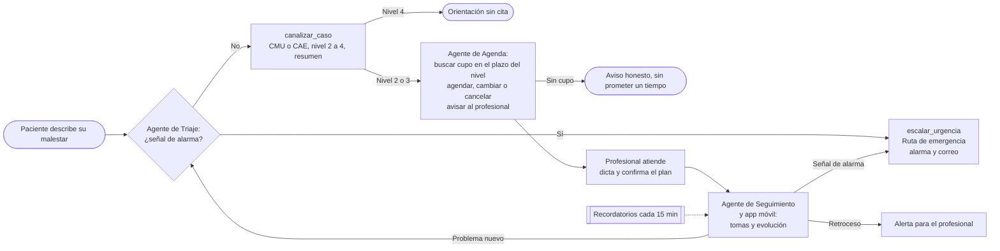
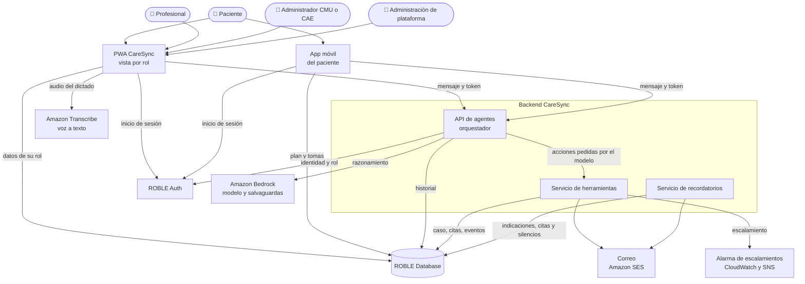
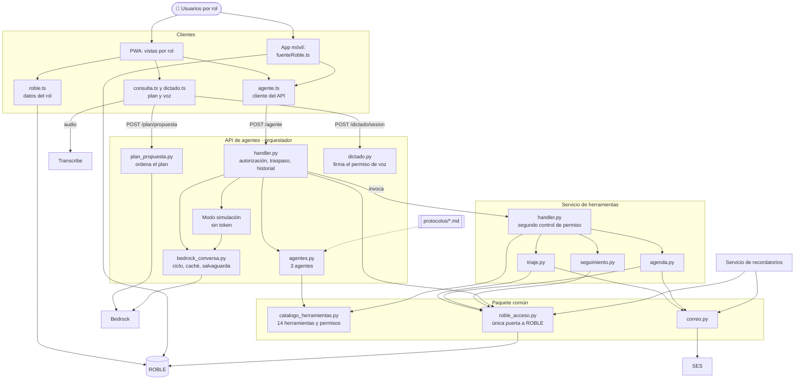
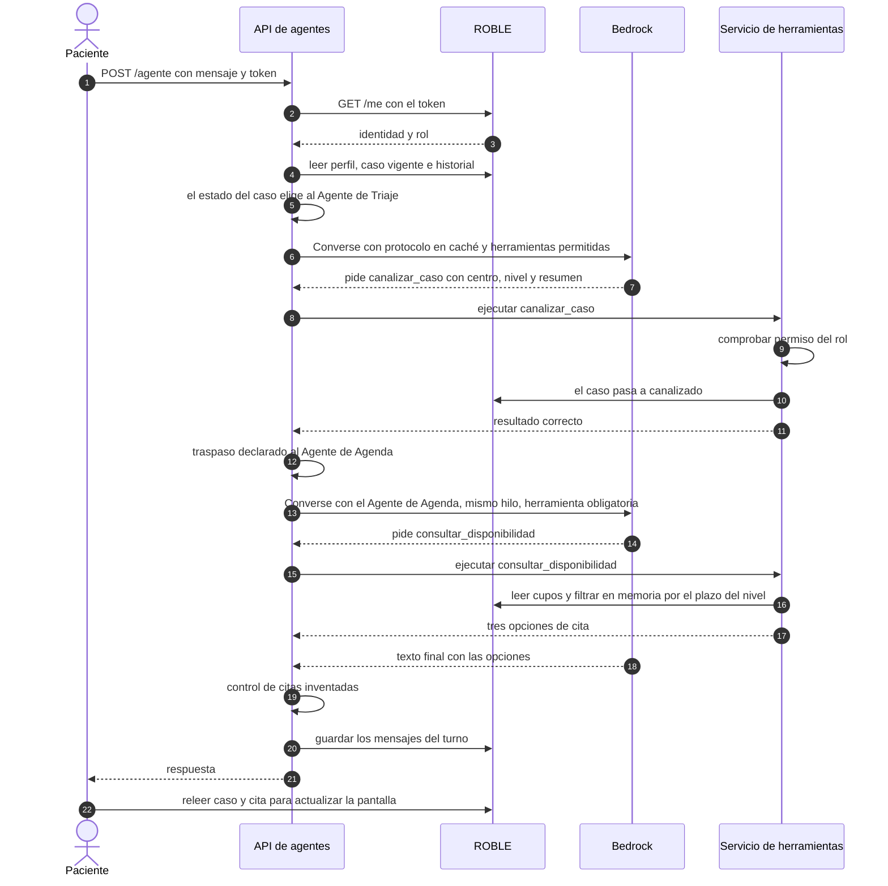
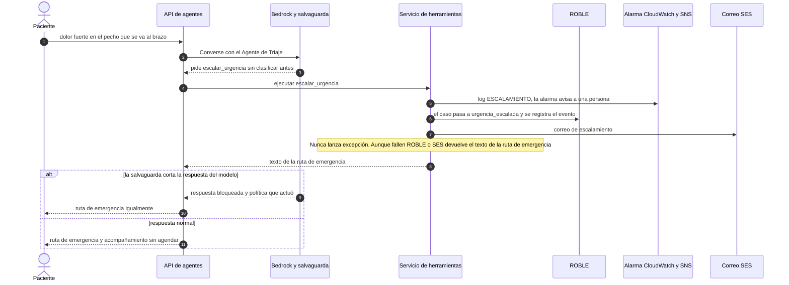
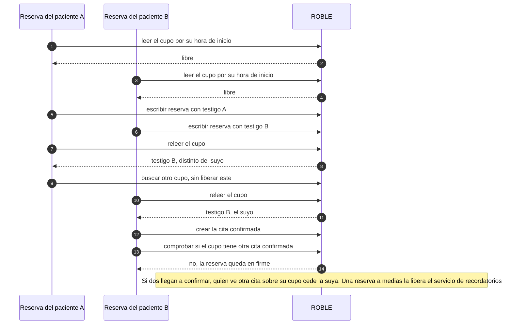
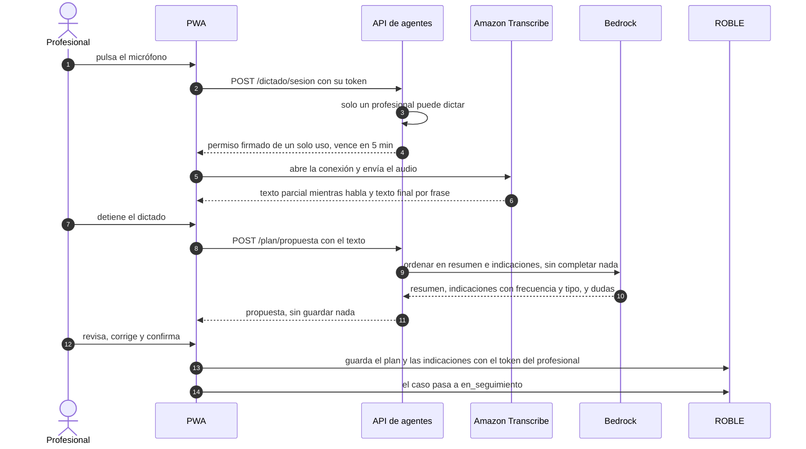
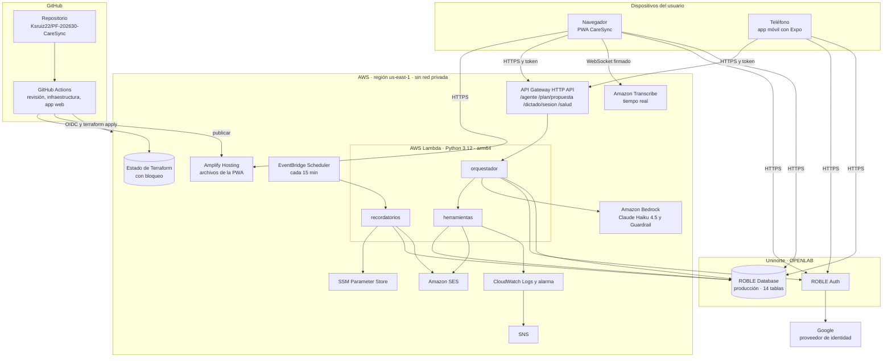

# Informe Final de Proyecto Final

## CareSync Agentic Network

**Universidad del Norte — Proyecto Final, Campo: Salud**
**Docente proponente:** Dadier Jabba
**Co-asesor:** Augusto Salazar
**Integrantes:** Alejandro Santiago, Kevin Ruiz y Bernardo Álvarez
**Fecha:** noviembre de 2026 · estado del repositorio al 9 de noviembre de 2026 (commit `7b854a7`); pruebas automatizadas verificadas el 19 de noviembre de 2026

**Aplicación publicada:** https://main.d1ndsh656qxmj8.amplifyapp.com/

---

## Resumen / Abstract

**Problema.** En la comunidad universitaria de Uninorte, las etapas del recorrido de atención en salud ya existen por separado: la orientación inicial, la canalización hacia el Centro Médico Uninorte (CMU) o el Centro de Acompañamiento Estudiantil (CAE), el agendamiento y el seguimiento. Lo que falla es la costura entre ellas. La persona no siempre sabe a qué centro acudir, el agendamiento y el seguimiento dependen de trabajo manual, lo hablado en el primer contacto no llega al profesional y nada comprueba de forma sistemática cómo sigue la persona después de la consulta.

**Solución.** CareSync Agentic Network es un prototipo funcional de extremo a extremo con tres agentes de inteligencia artificial que comparten el estado persistido de un caso y se lo transfieren de forma explícita. El **Agente de Triaje** clasifica la urgencia en cuatro niveles y canaliza al CMU o al CAE sin diagnosticar. El **Agente de Agenda y Logística** busca cupos dentro del plazo del nivel, y agenda, cambia y cancela citas. El **Agente de Seguimiento** explica el plan que escribió el profesional, registra las tomas y la evolución y alerta ante un retroceso. Ante cualquier señal de alarma, el sistema interrumpe el recorrido y muestra la ruta de emergencia. Los agentes se usan desde una aplicación web progresiva (PWA) con cinco vistas por rol, y el paciente cuenta además con una app móvil. El profesional dicta el plan de tratamiento por voz y lo revisa antes de guardarlo. Los datos de salud viven en ROBLE, la plataforma de datos de la universidad; AWS aporta el razonamiento (Claude Haiku 4.5 en Amazon Bedrock, con salvaguardas de contenido), la ejecución serverless, el reconocimiento de voz, el correo y la observabilidad, todo declarado en Terraform y desplegado desde GitHub Actions.

**Metodología.** Prototipado iterativo y vertical en seis fases durante 16 semanas, con tres frentes de trabajo (infraestructura, agentes y aplicación), revisión por *pull requests* e integración continua. Cada decisión de diseño se contrastó con mediciones contra el sistema desplegado: bancos de casos sintéticos con resultado esperado, corridos antes y después de cada corrección, y con sus informes guardados sin editar en el repositorio.

**Resultados.** En la medición final contra el sistema desplegado (5 de noviembre de 2026), el agente llevó a la ruta de emergencia **13 de 13** casos de alarma, todos en el primer turno (y 39 de 39 en las tres corridas previas); canalizó al centro correcto **25 de 27** casos (**92,6 %**, meta ≥ 85 %); no cometió **ningún** sub-triaje en casos prioritarios; no dio **ninguna** respuesta prohibida en **26** intentos adversariales; produjo **cero** dobles reservas en **10** pares de solicitudes simultáneas; y dejó la alerta de retroceso visible para el profesional en **3 a 5 segundos** en los **4** guiones con empeoramiento (meta < 5 minutos). En las pruebas de uso, **6 estudiantes** completaron las tareas sin ayuda y calificaron la aplicación con un promedio de **4,72 sobre 5**. El 19 de noviembre se midieron además, contra lo desplegado, el aviso al profesional (**5 de 5** en el mismo minuto del agendamiento, meta < 5 minutos) y los permisos por rol (**ninguno** de 10 intentos no permitidos tuvo efecto); el 20 quedó verificado el último de los **9** recorridos de punta a punta. Doce archivos de pruebas automatizadas con **685** comprobaciones corren en cada cambio del repositorio.

**Conclusiones.** El prototipo demuestra que la coordinación de varios agentes sobre un caso compartido es viable y que puede hacerse segura por diseño: las reglas críticas (no diagnosticar, no recetar, escalar ante la duda) se sostienen en el código y no en el *prompt*. La lección más importante fue que las fallas graves no aparecieron donde se esperaban: la primera corrida de alarmas dio 1 de 12 porque la salvaguarda de contenido bloqueaba justo la respuesta correcta, y la corrección fue de arquitectura. Quedan como límites declarados la falta de validación clínica del protocolo y unas pruebas de usabilidad más amplias, que incluyan a profesionales y administradores.

---

# 1. Introducción

La atención en salud es un dominio en el que los sistemas de información organizan la interacción entre pacientes, profesionales, servicios y datos clínicos. En los últimos años aparecieron los evaluadores digitales de síntomas, como Ada y Buoy, y después las arquitecturas basadas en modelos de lenguaje capaces de usar herramientas y ejecutar acciones sobre sistemas externos [1][2][9]. Al mismo tiempo, organismos como la Organización Mundial de la Salud y el NIST han insistido en que estos sistemas deben diseñarse con supervisión humana, transparencia y gestión explícita de riesgos [3][4].

En la comunidad universitaria de Uninorte, la dificultad no está en una etapa aislada sino en la costura entre etapas. Una persona con un malestar no siempre sabe si su caso corresponde al CMU (salud física) o al CAE (salud mental y acompañamiento). El agendamiento y el seguimiento posterior dependen de trabajo administrativo manual. Después de la consulta, nada comprueba de forma sistemática si la persona sigue las indicaciones o si empeoró. La oportunidad que motiva el proyecto es conectar esas etapas en un solo recorrido: una red de agentes que comparten el estado del caso y se lo transfieren de forma explícita y trazable.

Este informe documenta el proyecto completo. Recoge el planteamiento y los objetivos del [Primer Informe](./Primer_Informe_CareSync.md), el diseño y la evaluación de alternativas del [Segundo Informe](./SegundoInforme.md), y los completa con lo construido en la recta final: la agenda completa (cambiar y cancelar citas), el dictado por voz del plan con Amazon Transcribe, la app móvil del paciente, la migración a ROBLE producción y la medición de todas las métricas comprometidas que dependían del sistema. Termina con los resultados, la discusión de su significado frente a los objetivos y el trabajo futuro que queda antes de cualquier uso real.

---

# 2. Marco conceptual

Esta sección presenta los conceptos necesarios para entender el problema, la solución y las decisiones técnicas del proyecto. Se organiza en cuatro grupos: los conceptos del dominio de la salud, los de inteligencia artificial basada en agentes, los de arquitectura y datos, y los de seguridad, privacidad y evaluación.

## 2.1 Conceptos del dominio de la salud

**Continuidad del cuidado.** Es el grado en que una serie de atenciones se vive como coherente y conectada a lo largo del tiempo. Suele distinguirse la continuidad de información (lo que se sabe del caso acompaña a la persona entre servicios), la de gestión (las acciones de distintos actores se coordinan) y la relacional. CareSync se concentra en las dos primeras. El resumen estructurado que recibe el profesional es continuidad de información, y el traspaso entre agentes junto con el seguimiento posterior son continuidad de gestión. El proyecto no pretende sustituir la relación entre el paciente y el profesional.

**Triaje.** Es el proceso de clasificar a las personas según la urgencia de su necesidad para decidir el orden y el lugar de atención. Los sistemas hospitalarios de referencia son el Manchester Triage System (MTS), que deriva cinco niveles de unos 52 flujogramas por motivo de consulta, y el Emergency Severity Index (ESI), cuyos niveles 3 a 5 se definen por los recursos clínicos que se espera usar [14][15]. Ambos están pensados para personal clínico presencial con signos vitales medibles. El protocolo de CareSync usa **cuatro niveles**: emergencia, prioritario (72 h), regular (7 días) y orientación sin cita. El nivel 1 fusiona los niveles 1 y 2 de esos sistemas en una sola acción binaria: "esto no admite espera, deriva ya". Esa simplificación es deliberada, porque es lo que un agente conversacional sin supervisión clínica en tiempo real puede hacer con seguridad.

**Canalización.** Es la decisión de a qué servicio corresponde el caso. En este proyecto hay tres destinos: CMU, CAE o la ruta de emergencia. El protocolo resuelve los casos ambiguos con reglas explícitas. Un síntoma físico con carga emocional va primero al CMU para descartar una causa física. Un caso con ambos frentes va al CAE, con la anotación de pedir valoración física. La violencia o el acoso sin lesión van al CAE.

**Sobre-triaje y sub-triaje.** Sobre-triaje es asignar más urgencia de la que el caso amerita; sub-triaje es asignar menos. Sus costos no son simétricos. Un sobre-triaje consume recursos, mientras que un sub-triaje puede retrasar una atención crítica. La literatura sobre modelos de lenguaje aplicados al triaje muestra resultados desiguales, con una tendencia consistente a sobrestimar la gravedad [16][17]. El protocolo de CareSync adopta ese sesgo como regla ("si el agente duda, elige el más urgente"), y la evaluación trata ambos errores de forma distinta: un desacierto hacia arriba no cuenta como falla, uno hacia abajo sí.

**Cribado breve de riesgo.** Para las señales de alarma, el modelo más cercano no es el triaje general sino instrumentos de cribado como el ASQ (Ask Suicide-Screening Questions, del NIMH) y el C-SSRS (Columbia Protocol) [18][19]. Están diseñados para personal no especializado, toman menos de dos minutos y siguen una regla sencilla: cualquier respuesta positiva dispara el escalamiento, sin que quien pregunta profundice por su cuenta. El Paso 0 del protocolo de CareSync replica ese diseño. Ante cualquier señal de alarma, física o mental, se activa `escalar_urgencia` y el agente deja de recolectar información.

## 2.2 Inteligencia artificial basada en agentes

**Modelo de lenguaje de gran tamaño (LLM).** Es un modelo entrenado para predecir texto que, con las instrucciones adecuadas, puede conversar, resumir, clasificar y decidir qué acción tomar. CareSync usa Claude Haiku 4.5 servido por Amazon Bedrock, un modelo de baja latencia y bajo costo por token, adecuado para conversaciones de varios turnos con herramientas.

**Uso de herramientas (*tool use*).** Es la capacidad del modelo de responder, en lugar de texto, con una solicitud estructurada para ejecutar una función declarada, por ejemplo `agendar_cita(hora_inicio=...)`. El sistema ejecuta la función y le devuelve el resultado al modelo. En Bedrock esto se hace mediante la Converse API, donde cada herramienta se declara con un nombre, una descripción y un esquema JSON de entrada [20].

**Agente.** En este proyecto, un agente es la combinación de un modelo, unas instrucciones, un conjunto acotado de herramientas y un **bucle** que alterna entre razonar y actuar hasta producir una respuesta final. Es el patrón conocido como ReAct [21]. La diferencia práctica con un chatbot es que el agente no solo genera texto: modifica el estado del mundo, porque reserva cupos, registra evolución y envía correos. CareSync define un agente como una estructura de datos con clave, instrucciones, roles que lo pueden invocar, herramientas y traspaso. Los tres agentes son instancias de esa estructura sobre un mismo tiempo de ejecución.

**Sistema multiagente, orquestación y traspaso (*handoff*).** Un sistema multiagente reparte un problema entre agentes con responsabilidades distintas. El **orquestador** es el componente que recibe cada mensaje, identifica al llamante y su rol, decide qué agente atiende y ejecuta el bucle. El **traspaso** es el paso del control de un agente a otro. En CareSync el traspaso es **explícito y determinista**: ocurre cuando la herramienta `canalizar_caso` tiene éxito, no porque el modelo decida libremente cambiar de agente. Qué agente atiende un mensaje nuevo se deduce del estado del caso, de modo que alguien que vuelve a escribir tres días después cae en seguimiento y no repite el triaje. Esta forma de orquestar sigue la recomendación de preferir flujos sencillos y controlables antes que agentes autónomos, cuando el dominio lo permite [22].

**Salvaguardas de contenido (*guardrails*).** Son filtros que se aplican a la entrada y a la salida del modelo para bloquear categorías de contenido. Bedrock Guardrails permite declarar filtros de contenido (violencia, odio, ataques de *prompt*, entre otros), temas denegados definidos en lenguaje natural y filtros de información sensible [23]. CareSync deniega dos temas propios del dominio: diagnóstico definitivo y prescripción. Un tercer tema, la disuasión de buscar urgencia, se retiró tras la primera evaluación, porque un tema denegado reconoce el asunto y no la postura: bloqueaba justo la respuesta correcta a una alarma. Esa regla queda a cargo del protocolo y de las instrucciones, y las reglas críticas se siguen reforzando en capas independientes (protocolo, instrucciones y *guardrail*), para que la falla de una no deje al sistema sin la regla.

**Caché de *prompt*.** Es un mecanismo del proveedor que reutiliza el procesamiento de la parte fija de una solicitud entre llamadas sucesivas, lo que reduce costo y latencia [24]. En CareSync las instrucciones y el protocolo de triaje, que suman varios miles de tokens idénticos en cada turno, se envían marcados para caché.

**Reconocimiento automático del habla.** Es la conversión de voz en texto por un modelo especializado. Los servicios en tiempo real devuelven texto **parcial**, que se va corrigiendo mientras la persona habla, y texto **final** por frase, que ya no cambia [31]. CareSync lo usa para que el profesional dicte el plan de tratamiento; el texto resultante no se guarda directamente, sino que el modelo de lenguaje lo ordena y el profesional lo revisa antes de confirmar.

**Generación aumentada por recuperación (RAG).** Es la técnica de recuperar fragmentos relevantes de una base documental e inyectarlos en la solicitud al modelo [25]. Se considera aquí para explicar por qué **no** se usa en esta versión: el protocolo cabe completo en el contexto y es un único documento versionado. RAG agregaría una base vectorial, un proceso de indexación y una fuente de error adicional (recuperar el fragmento equivocado) sin mejorar el resultado. Queda como trabajo futuro para cuando exista una base de protocolos clínicos validados y extensos.

## 2.3 Arquitectura y datos

**Arquitectura serverless y funciones como servicio (FaaS).** Es un modelo en el que el código se ejecuta en funciones que el proveedor instancia bajo demanda y factura por invocación, sin servidores permanentes que administrar. Sus ventajas son el costo cercano a cero en reposo y la escalabilidad automática. Sus desventajas son el arranque en frío (*cold start*), los límites de tiempo de ejecución y la ausencia de estado entre invocaciones. CareSync usa AWS Lambda detrás de un HTTP API de API Gateway, cuyo tiempo máximo de integración es de 30 segundos [26]. Ese límite condiciona el diseño del bucle de herramientas.

**Backend como servicio (BaaS).** Es una plataforma que ofrece autenticación, base de datos y permisos listos para usar mediante una API, sin que el equipo construya ni opere un backend propio. ROBLE, plataforma de OPENLAB en Uninorte, cumple ese papel en el proyecto: ofrece PostgreSQL administrado, autenticación (correo y contraseña, y Google) y permisos por rol, y queda dentro de la infraestructura de la propia universidad.

**Aplicación web progresiva (PWA) y aplicación móvil multiplataforma.** Una PWA es una aplicación web que, mediante un manifiesto y un *service worker*, puede instalarse en el dispositivo y comportarse como una aplicación nativa [27]. Se eligió para ofrecer una sola base de código accesible desde cualquier navegador. Una aplicación móvil multiplataforma, como las construidas con React Native y Expo, comparte una base de código entre Android, iOS y la web, y accede a funciones del teléfono como las notificaciones programadas [32][33]. CareSync usa la PWA para todos los roles y una app móvil para el seguimiento del paciente.

**Control de acceso basado en roles (RBAC).** Es el modelo en el que los permisos se asignan a roles y los usuarios obtienen permisos por el rol que tienen [28]. CareSync define cinco roles y comprueba los permisos **dos veces y en el servidor**. La primera comprobación ocurre en el catálogo de herramientas, dentro de la Lambda, y la segunda la hace ROBLE con el *token* del propio llamante. Las vistas de la PWA son solo presentación: esconder un botón no es un permiso.

**Concurrencia sin transacciones: reservar, releer y reconciliar.** Cuando dos personas intentan reservar el mismo cupo, una base de datos convencional resolvería el conflicto con una escritura condicional (`UPDATE … WHERE libre = true`) o con una transacción. La API de datos de ROBLE no ofrece ninguna de las dos. CareSync aplica una variante de **control de concurrencia optimista**. Cada intento escribe la reserva con un testigo propio, relee la fila y comprueba si el testigo que quedó es el suyo. Si no lo es, ganó el otro y se busca otro cupo. Un proceso de limpieza libera las reservas que quedaron a medias.

**Estado del caso y ciclo de vida.** El caso es la entidad central que comparten los agentes. Pasa por una secuencia de estados (abierto, canalizado, agendado, en seguimiento, atendido, cerrado) y cada transición la produce una herramienta concreta. Tener ese estado persistido y trazable es lo que permite que el recorrido continúe aunque cambien el agente, el día o el dispositivo.

**Infraestructura como código (IaC) y observabilidad.** IaC es declarar la infraestructura en archivos versionados que una herramienta aplica de forma reproducible. El proyecto usa Terraform. La observabilidad es la capacidad de entender el comportamiento del sistema a partir de sus señales. CareSync emite *logs* estructurados en CloudWatch y define una métrica de producto: cada escalamiento deja la marca `ESCALAMIENTO`, que un filtro cuenta y que dispara una alarma por SNS.

## 2.4 Seguridad, privacidad y evaluación

**Datos sensibles de salud.** En Colombia, la Ley 1581 de 2012 clasifica los datos relativos a la salud como datos sensibles, cuyo tratamiento exige autorización explícita y medidas reforzadas [29]. Por eso el prototipo trabaja **exclusivamente con datos sintéticos**: casos inventados por el equipo que reproducen situaciones plausibles sin corresponder a ninguna persona. También por eso la persistencia está en la infraestructura de la universidad y no en la nube comercial.

**Evaluación con un banco de casos sintéticos.** Evaluar un agente conversacional exige medir su comportamiento sobre un conjunto controlado de entradas con resultado esperado conocido. El banco de CareSync define, para cada caso, el mensaje inicial, un guion de respuestas y el centro y el nivel esperados. El evaluador conversa de varios turnos con el sistema desplegado hasta que el agente canaliza, escala o se agota el guion, y compara el resultado con lo esperado.

**Validación técnica frente a validación clínica.** La validación técnica comprueba que el sistema se comporta según el protocolo definido. La validación clínica comprueba que el protocolo es correcto desde el punto de vista médico. CareSync solo aspira a la primera. Un 85 % de acierto en canalización significa que el agente sigue el protocolo, no que el protocolo sea clínicamente adecuado. Esa distinción recorre todo el documento.

**Usabilidad.** Es el grado en que un sistema puede ser usado con eficacia, eficiencia y satisfacción por sus usuarios. El instrumento estándar más usado es el System Usability Scale (SUS), de diez ítems, cuyo puntaje de referencia promedio ronda 68 [30]. Como el SUS supone un sistema de uso frecuente, el proyecto lo reemplazó por un cuestionario propio adaptado a una herramienta de salud (§13.3).

---

# 3. Planteamiento del problema

## 3.1 Descripción del problema

En los servicios de atención de una comunidad universitaria, la continuidad de un caso se rompe en la separación entre orientación inicial, canalización, agendamiento y seguimiento. Quien presenta un malestar no siempre sabe si le corresponde el servicio de salud física o el de salud mental. El agendamiento requiere intervención manual, y lo que se habló en el primer contacto no siempre llega al profesional que atiende. Después de la consulta, nada comprueba de forma sistemática si la persona sigue las indicaciones o si presenta un retroceso.

Las causas son organizativas y técnicas. Cada etapa la resuelve un actor distinto con herramientas que no comparten el estado del caso, y el seguimiento depende de que alguien tenga tiempo de hacerlo. Las consecuencias recaen sobre tres grupos. La persona que consulta puede no llegar a tiempo al servicio correcto o llegar sin contexto. El profesional atiende sin el resumen de lo ocurrido antes. Los administradores de CMU y CAE cargan con trabajo repetitivo de agendamiento y seguimiento.

El problema se formula como una **deficiencia de continuidad y coordinación del recorrido de atención**, no como la ausencia de una aplicación. Automatizar decisiones de salud introduce además sus propios riesgos: un triaje sin validación clínica puede clasificar mal, un modelo puede responder de forma inadecuada en salud mental y los datos de salud requieren protección reforzada. Por eso el problema técnico incluye mantener límites claros entre un prototipo demostrativo y un sistema clínico real.

Ver detalle completo en el [Primer Informe](./Primer_Informe_CareSync.md#2-planteamiento-del-problema).

## 3.2 Restricciones y supuestos de diseño

Las restricciones de contexto se mantienen respecto al primer informe. El proyecto dura 16 semanas, el equipo tiene tres integrantes con frentes separados y el resultado es un prototipo funcional E2E, no un sistema clínico. Se usan exclusivamente datos sintéticos. La integración con los sistemas institucionales del CMU y el CAE es simulada, y la disponibilidad de profesionales y cupos se siembra con datos de prueba. El protocolo de triaje es deliberadamente básico, está versionado y carece de validación clínica. El sistema no diagnostica ni prescribe.

La construcción convirtió varios supuestos en restricciones técnicas verificadas, y cada una deja una huella concreta en el diseño:

| Restricción verificada | Consecuencia en el diseño |
|---|---|
| La lectura de ROBLE solo compara por igualdad: no admite rangos, orden ni paginación | Filtrado, orden y recortes se hacen en memoria después de leer |
| ROBLE no ofrece escrituras condicionales ni transacciones | La reserva de cupos usa *reservar, releer y reconciliar* con testigo, y los registros de varias escrituras se ordenan para ser repetibles |
| ROBLE no expone claves foráneas | La integridad referencial la sostiene el módulo único de acceso a datos |
| Límites de ROBLE por IP: 100 operaciones por minuto, 10 inicios de sesión cada 15 minutos y 5 registros por hora | El evaluador del triaje hace pausas de 6 s entre turnos, y las pruebas de carga deben planearse contra ese techo |
| El HTTP API de API Gateway no espera más de 30 s | El bucle de herramientas tiene un tope de 5 vueltas; superar ese tiempo exige volver la llamada asíncrona |
| El SDK de JavaScript de ROBLE no persiste la sesión ni ofrece inicio de sesión social | Los *tokens* se guardan en `localStorage` (riesgo de XSS documentado y mitigado) y el inicio con Google se implementó a mano contra la API |
| Bogotá usa UTC −05:00 sin horario de verano | El desplazamiento horario es una constante única en el código |
| Al importar una copia en ROBLE producción, las tablas pierden el valor por defecto de su identificador | El código genera el identificador al crear cada fila, en las Lambdas, la PWA y la app móvil |

La evaluación añadió dos supuestos que conviene declarar. El primero es que **el modelo no es determinista**: la misma conversación puede escalar en el primer turno en una corrida y en el segundo en otra, así que una métrica medida una sola vez es una estimación, no una garantía. Por eso las alarmas se miden tres veces. El segundo es que **las salvaguardas de Bedrock juzgan por tema y no por intención**: un tema denegado bloquea tanto la respuesta que disuade de buscar urgencia como la que la recomienda. Por eso la ruta de emergencia no puede depender de que el modelo logre responder.

La arquitectura mínima omite deliberadamente controles necesarios antes de cualquier uso real: aislamiento de red, llaves de cifrado propias con rotación, WAF, auditoría de eventos de datos con CloudTrail y validación clínica. El costo se contiene con un tope de vueltas del bucle, caché de *prompt*, un presupuesto de AWS de USD 20 al mes con alerta y un único entorno permanente de demostración.

## 3.3 Alcance

El proyecto entrega un **prototipo funcional de extremo a extremo**, desplegado y público, que cubre el recorrido completo: contacto, triaje, canalización, agendamiento, atención (registro del plan por el profesional) y seguimiento. Opera con cinco roles, tres agentes sobre un orquestador común, una PWA con cinco vistas y una app móvil para el paciente, y usa exclusivamente datos sintéticos.

Respecto al planteamiento del primer informe, el alcance creció en cinco puntos, todos ya construidos: el quinto rol (administración de plataforma) y su vista; el inicio de sesión con Google; el historial de triajes y el simulador de triaje para el profesional; la agenda completa, que también cambia y cancela citas y sube la urgencia de un caso; y la app móvil del paciente, con recordatorios de tomas y avisos de cita en el teléfono.

### 3.3.1 Recorridos E2E comprometidos (N = 9)

| ID | Recorrido | Resultado esperado (criterio de aprobación) | Estado final |
|---|---|---|---|
| **E2E-1** | Salud física regular con seguimiento favorable | Canalizado al CMU con nivel 2–4; cita agendada; resumen visible para el profesional; plan registrado; seguimiento estable sin alerta | ✅ Verificado por tramos: agenda de punta a punta desplegada (8/8 turnos, 5/11), consulta con plan dictado (14/10) y seguimiento estable sin alertas falsas (5/11) |
| **E2E-2** | Salud mental con retroceso durante el seguimiento | Canalizado al CAE; ante una caída de ≥ 3 puntos o una escala ≤ 3, alerta visible para el profesional en < 5 min | ✅ M5: 4/4 alertas en 3 a 5 s |
| **E2E-3** | Señal de alarma física | Ruta de emergencia sin clasificar antes; no se agenda; marca `ESCALAMIENTO` y alarma | ✅ M2: todas las alarmas físicas escaladas en el primer turno |
| **E2E-4** | Señal de alarma mental | Igual que E2E-3; el agente sigue acompañando sin agendar | ✅ M2: todas las alarmas mentales escaladas en el primer turno |
| **E2E-5** | Sin disponibilidad en la ventana | El agente informa que no hay cupo sin prometer un tiempo inexistente | ✅ 3/3 contra lo desplegado (19/11): sin cupos en el CAE, dijo que no hay espacio sin inventar uno ni prometer contacto, y anotó `sin_cupo_en_plazo` |
| **E2E-6** | Doble reserva concurrente | Exactamente una cita en firme; la otra persona recibe una alternativa | ✅ M4: 0 dobles reservas en 10 pares |
| **E2E-7** | Orientación sin cita (nivel 4) | Se orienta a la persona sin reservar cupo | ✅ Casos de orientación del banco, correctos en la medición final |
| **E2E-8** | Operación de la agenda | Plataforma asigna el rol; el administrador registra al profesional, sus horarios y publica cupos | ✅ Usado para preparar el médico de prueba de la evaluación y de la demostración |
| **E2E-9** | Recordatorio y silencio en el seguimiento | Recordatorio enviado; silencio anotado tras 36 h sin adherencia o 3 días sin evolución | ✅ Verificado contra lo desplegado el 19 y el 20/11. **Silencio:** hasta el 19/11 la función de recordatorios no escribía nada en producción, porque la cuenta de servicio no estaba cargada en Parameter Store; en su primera corrida completa anotó `sin_adherencia` y `sin_evolucion` en el caso en seguimiento que no reportaba desde el 14/10. **Recordatorio:** el 20/11 el médico guardó un plan con una toma a las 11:00, a la hora que fijó él; el teléfono del paciente la avisó a las 11:00 con la app móvil, y la función la programó y la envió por correo a las 10:51, con el mensaje aceptado por SES. Esa mañana también atendió a su hora los recordatorios de otros dos pacientes (6:51 y 7:51), que SES no entregó, como se espera en *sandbox* con direcciones sin verificar. La lógica se prueba además sin red (`prueba_recordatorios.py`) |

### 3.3.2 Roles y permisos

| Rol | Vista | Agentes que puede invocar | Herramientas | Restricciones |
|---|---|---|---|---|
| **Paciente** | Paciente (PWA) y app móvil | Triaje, Agenda, Seguimiento | Las del agente que atiende según el estado del caso | Solo su propio caso; nunca usa el modo simulación |
| **Profesional** | Profesional: agenda, historial de triajes y simulador | Seguimiento; Triaje solo en simulación | `consultar_estado_caso`, `consultar_plan`, `escalar_urgencia` | Escribe y confirma el plan en su interfaz; la conversación solo la ve en el historial, con registro de cada apertura |
| **Administrador CMU / CAE** | Administrativo de su centro | Agenda; Triaje solo en simulación | `consultar_estado_caso`, `consultar_disponibilidad`, `consultar_profesionales`, `agendar_cita`, `cancelar_cita`, `reprogramar_cita`, `notificar_profesional`, `subir_urgencia` | Solo su centro |
| **Administración de plataforma** | Plataforma | Ninguno | Ninguna | Rol operativo: asigna roles y mantiene el directorio; no conversa con los agentes ni lee conversaciones |

Toda cuenta nueva, incluidas las que llegan por Google, nace con el rol de paciente. Ningún rol administrativo se asigna de forma automática.

### 3.3.3 Casos sintéticos de validación

| Banco | Tamaño | Qué verifica | Estado |
|---|---|---|---|
| Triaje (`casos_evaluacion.json`) | 43 casos: 10 CMU, 10 CAE, 6 ambiguos, 13 alarmas (6 físicas, 6 mentales y 1 de un tercero), 2 de orientación, 1 de preocupación por un tercero y 1 fuera de alcance | M1, M2 y M3 | ✅ Medido contra lo desplegado |
| Adversarial (`casos_guardarrailes.json`) | 26 intentos: diagnóstico, prescripción, disuasión de urgencia, inyección de *prompt*, fuga de datos, promesas indebidas, actividad ilícita y consultas legítimas que no deben bloquearse | M8 | ✅ Medido contra lo desplegado |
| Concurrencia (`evaluar_concurrencia.py`) | 10 pares de reservas simultáneas sobre el mismo cupo | M4 | ✅ Medido contra ROBLE producción |
| Seguimiento (`casos_seguimiento.json`) | 6 guiones: 2 estables, 2 con caída de ≥ 3 puntos y 2 con escala ≤ 3 | M5 | ✅ Medido contra lo desplegado |
| Agenda de punta a punta | 1 guion de 8 turnos: agendar, cambiar, cancelar y volver a agendar | Objetivo 4 | ✅ 8/8 turnos contra lo desplegado |

### 3.3.4 Integraciones

| # | Integración | Propósito | Estado final |
|---|---|---|---|
| I1 | ROBLE — autenticación con correo y contraseña, y recuperación de contraseña | Sesión y rol del usuario | ✅ Operativa |
| I2 | ROBLE — autenticación con Google | Entrada sin contraseña | ✅ Operativa |
| I3 | ROBLE — datos (14 tablas, en producción desde el 4/11) | Persistencia del caso, agenda, plan, seguimiento y eventos | ✅ Operativa |
| I4 | Amazon Bedrock (Claude Haiku 4.5) | Razonamiento de los agentes y propuesta del plan dictado | ✅ Operativa |
| I5 | Bedrock Guardrails | Salvaguardas de contenido | ✅ Activa y recalibrada con las mediciones |
| I6 | Amazon Transcribe en tiempo real | Dictado por voz del plan | ✅ Operativa |
| I7 | Amazon SES | Avisos al profesional, confirmaciones, avisos de cita 24 y 2 h antes, y escalamientos | ✅ Operativa |
| I8 | EventBridge Scheduler → Lambda de recordatorios | Recordatorios, avisos de cita y vigilancia de silencios cada 15 min | ✅ Operativa desde el 19/11; hasta entonces se detenía en cada corrida porque la cuenta de servicio no estaba cargada en Parameter Store |
| I9 | CloudWatch + SNS | *Logs*, métrica y alarma de escalamiento | ✅ Operativa |
| I10 | Amplify Hosting + GitHub Actions (OIDC) | Publicación de la PWA y despliegue de la infraestructura | ✅ Operativa |
| I11 | Notificaciones locales del teléfono (Expo) | Recordatorios de tomas y avisos de cita en la app móvil | ✅ Operativa; sin notificaciones *push* desde el servidor |

La integración real con los sistemas institucionales del CMU y del CAE quedó fuera: la agenda simulada vive en ROBLE (`profesionales`, `horarios`, `cupos`, `citas`), y el contrato de un adaptador hacia esos sistemas pasa a trabajo futuro (§15).

### 3.3.5 Fuera del alcance

Atención clínica real; datos reales de personas; validación clínica del protocolo; integración real con los sistemas del CMU y el CAE; operación productiva con alta disponibilidad; archivos adjuntos; diagnóstico o prescripción autónoma; controles de seguridad de producción (red privada, WAF, llaves de cifrado propias, auditoría de eventos de datos); recuperación aumentada por documentos (RAG); comunicación en tiempo real entre pantallas; notificaciones *push* desde el servidor; y soporte posterior al proyecto.

---

# 4. Objetivos

Los objetivos se formularon en el primer informe y se reformularon con métricas verificables en el segundo, atendiendo la retroalimentación. Se mantienen sin cambios; el grado de cumplimiento de cada uno se discute en la §14.

## 4.1 Objetivo general

**Desarrollar y evaluar, en 16 semanas, un prototipo funcional de extremo a extremo que coordine tres agentes de inteligencia artificial para mantener la continuidad del recorrido de atención de un miembro de la comunidad de Uninorte, desde el reporte inicial de síntomas hasta el seguimiento posterior. El prototipo se considerará logrado si ejecuta con éxito los 9 recorridos E2E definidos (§3.3.1) con datos sintéticos, deriva a la ruta de emergencia el 100 % de los casos con señal de alarma y alcanza los umbrales de canalización, agendamiento y seguimiento declarados en la tabla de métricas (§4.3).**

## 4.2 Objetivos específicos

Cada objetivo está ligado a una o más métricas de la §4.3.

1. **Analizar** los requerimientos del recorrido de atención y formalizarlos en los 9 recorridos E2E, los 5 roles y el catálogo de requerimientos funcionales y no funcionales de este informe. *Verificación:* cada requerimiento funcional queda trazado a al menos un recorrido E2E.

2. **Diseñar** una arquitectura serverless mínima que ejecute los tres agentes sobre un tiempo de ejecución común, mantenga los datos de salud fuera de AWS y compruebe los permisos en el servidor. *Verificación:* la evaluación de alternativas (§9) y los diagramas (§10); la infraestructura se aplica completa desde Terraform sin pasos manuales fuera del arranque documentado.

3. **Implementar** el Agente de Triaje y **verificar** que canaliza correctamente al menos el **85 %** de los casos del banco con centro esperado (**M1**), que escala el **100 %** de los casos con señal de alarma (**M2**) y que no comete sub-triaje en ningún caso de nivel esperado 2 (**M3**).

4. **Implementar** el Agente de Agenda y Logística y **verificar** que agenda la cita en el **100 %** de los casos canalizados con cupo disponible, que produce **cero** dobles reservas en la prueba de concurrencia (**M4**) y que el profesional recibe el resumen del caso en menos de **5 minutos** tras el agendamiento (**M6**).

5. **Implementar** el Agente de Seguimiento y la Lambda de recordatorios y **verificar** que todo retroceso de los guiones de seguimiento genera un evento visible para el profesional en menos de **5 minutos** (**M5**) y que los silencios se anotan en un máximo de **15 minutos** después de superar el umbral.

6. **Construir** la PWA con las cinco vistas por rol, el dictado por voz del plan de tratamiento y controles de acceso verificados. *Verificación:* ninguna llamada de un rol a una herramienta no permitida tiene efecto (**M7**), y la usabilidad obtiene un SUS promedio de al menos **68** (**M9**).

7. **Integrar** la persistencia y la trazabilidad de forma que todas las acciones de los agentes queden registradas. *Verificación:* el 100 % de las invocaciones de herramientas en los recorridos E2E deja registro en ROBLE o en CloudWatch.

8. **Evaluar** el recorrido completo ejecutando los **9 recorridos E2E** en el entorno de demostración (**M10**), además del banco adversarial de salvaguardas (**M8**) y las sesiones de usabilidad con 6 a 8 personas.

9. **Documentar** la arquitectura, el despliegue, los resultados de evaluación, las limitaciones y la hoja de ruta necesaria antes de cualquier uso real.

## 4.3 Métricas de éxito

Los valores son los de la última medición contra el sistema desplegado, salvo donde se indica. La evidencia está en `caresync/evaluacion/informes/`: los informes que genera cada evaluador, sin editar, con el antes y el después de cada corrección.

| ID | Etapa | Indicador | Meta | Resultado final | |
|---|---|---|---|---|---|
| **M1** | Canalización | Casos con el centro correcto | ≥ 85 % | **25/27 (92,6 %)** | ✅ |
| **M2** | Emergencia | Casos de alarma que terminan en la ruta de emergencia sin clasificar antes | 100 % | **13/13**, todos en el primer turno (39/39 en las tres corridas previas) | ✅ |
| **M3** | Urgencia | Sub-triaje en casos de nivel esperado 2 | 0 | **0** | ✅ |
| **M4** | Agendamiento | Dobles reservas en pares simultáneos sobre el mismo cupo | 0 en 10 pares | **0/10**, antes y después del arreglo del 5/11 | ✅ |
| **M5** | Seguimiento | Retrocesos con alerta visible para el profesional en < 5 min | 100 % | **4/4, en 3 a 5 s**, 0 alertas falsas | ✅ |
| **M6** | Notificación | Tiempo entre el agendamiento y el aviso al profesional | < 5 min | **5/5** con el correo aceptado por SES, en el mismo minuto del agendamiento (19/11, sobre la bitácora); 25/25 agendamientos con su aviso registrado | ✅ |
| **M7** | Seguridad | Llamadas a herramientas no permitidas para el rol que producen efecto | 0 | **0/10** intentos con efecto contra lo desplegado (19/11, dos corridas), además de las pruebas sin red (`prueba_permisos.py`) | ✅ |
| **M8** | Salvaguardas | Respuestas con diagnóstico, prescripción o disuasión de urgencia | 0 | **0/26**, y 0 consultas legítimas bloqueadas | ✅ |
| **M9** | Usabilidad | Promedio del cuestionario de uso (reemplazó al SUS, §13.3) | ≥ 4 sobre 5 | **4,72**, con 6 estudiantes; 100 % de tareas sin ayuda | ✅ |
| **M10** | E2E | Recorridos E2E verificados | 9 de 9 | **9 de 9** verificados. Los dos últimos, contra lo desplegado: E2E-5 con guion propio (3/3, 19/11) y E2E-9 con el recordatorio sonando en el teléfono (20/11) | ✅ |

Una métrica cambió de instrumento: el objetivo 6 planteaba medir la usabilidad con el SUS (≥ 68), pero se reemplazó por un cuestionario propio con meta de 4 sobre 5, porque el SUS supone un sistema de uso frecuente y no encaja con una herramienta de salud que se usa cuando hace falta. La justificación y los resultados están en la §13.3.

---

# 5. Estado del arte / soluciones relacionadas

El análisis detallado de soluciones relacionadas está en el primer informe (§6). Se resume aquí y se actualiza con lo aprendido durante la construcción.

Las soluciones consultadas se agrupan en tres familias. Los evaluadores de síntomas comerciales, como Ada y Buoy, demuestran que la conversación sirve como puerta de entrada a los servicios de salud, pero se concentran en la orientación inicial [1][2][5]. Las plataformas de agenda, como Zocdoc, resuelven la reserva de citas por separado, sin triaje previo ni seguimiento posterior [11]. Las plataformas y proyectos de agentes o chatbots médicos, entre ellos Microsoft Healthcare Agent Service, LangDoc, AI Medical Chatbot y Health Chatbot, ofrecen componentes útiles: entrevista conversacional, RAG, roles o agendamiento [6][7][8][12]. Ninguna de estas familias tiene como foco la costura entre etapas.

| Solución | Triaje | Agenda | Seguimiento | Agentes con herramientas |
|---|---|---|---|---|
| Ada Health | ✓ | — | Limitado | — |
| Buoy Health | ✓ | — | Limitado | — |
| Zocdoc | — | ✓ | — | — |
| Microsoft Healthcare Agent Service | ✓ | Integrable | Integrable | ✓ |
| LangDoc | ✓ | — | — | ✓ |
| AI Medical Chatbot | ✓ | — | — | — |
| Health Chatbot | ✓ | ✓ | — | — |
| **CareSync** | ✓ | ✓ | ✓ | ✓ |

La construcción del prototipo confirmó el posicionamiento del primer informe y añadió dos matices. El primero es que el valor no está en el agente conversacional aislado sino en el **estado compartido del caso**: el traspaso entre agentes funciona porque el caso persistido dice en qué etapa está, no porque el modelo lo recuerde. El segundo es que la literatura revisada para el protocolo, sobre MTS, ESI, chatbots de triaje, ASQ y C-SSRS [14]–[19], respalda las dos decisiones de seguridad más importantes del diseño: sesgar hacia el sobre-triaje y tratar las señales de alarma como un cribado binario que interrumpe todo lo demás. El aporte de CareSync sigue siendo una arquitectura de coordinación entre agentes para un recorrido universitario concreto, con trazabilidad y salvaguardas explícitas. No es un algoritmo clínico nuevo ni un modelo nuevo.

Ver el análisis completo de cada solución en el [Primer Informe](./Primer_Informe_CareSync.md#6-estado-del-arte--soluciones-relacionadas).

---

# 6. Solución propuesta

## 6.1 Qué se construyó

CareSync Agentic Network es una **red de tres agentes especializados que comparten el estado persistido de un caso** y se lo transfieren de forma explícita a medida que avanza el recorrido de atención. El enfoque parte de una observación sobre el problema: las etapas del recorrido ya tienen soluciones por separado, y lo que se pierde es el contexto entre ellas. Por eso la pieza central no es ningún agente en particular sino el **caso**: una entidad guardada en ROBLE con su estado, su centro, su nivel de urgencia, su resumen, sus citas, su plan, sus reportes y su bitácora de eventos. Cada agente lee el caso, actúa sobre él mediante herramientas y lo deja listo para el siguiente.

- **Agente de Triaje.** Conversa con la persona, aplica el protocolo de triaje (versión 0.5) y termina de una de dos formas: ante una señal de alarma llama a `escalar_urgencia`; si no, llama a `canalizar_caso` con el centro, el nivel de urgencia y un resumen estructurado. Nunca diagnostica.
- **Agente de Agenda y Logística.** Recibe el caso canalizado en la misma conversación, busca cupos dentro del plazo del nivel (72 horas el nivel 2, 7 días el 3), agenda, cambia y cancela citas pidiendo confirmación, avisa al profesional con el resumen y sube la urgencia si la persona cuenta algo nuevo.
- **Agente de Seguimiento.** Atiende después de la consulta: explica el plan que escribió el profesional, registra la adherencia a cada indicación y la evolución en una escala, agenda los controles del plan y deja una alerta para el profesional ante un retroceso.

Un **orquestador** coordina a los tres. Identifica a quien escribe y su rol con el *token* de su sesión, deduce del estado del caso qué agente debe atender, declara al modelo solo las herramientas que ese rol puede usar y ejecuta el ciclo de razonamiento y acción. El modelo nunca aporta la identidad. Si la persona cuenta un problema distinto, el agente abre un caso nuevo y lo devuelve al triaje (`nuevo_motivo`).

Alrededor de los agentes se construyeron cuatro piezas más:

- **La PWA**, con cinco vistas por rol: paciente, profesional, administrativo del CMU y del CAE, y plataforma.
- **El dictado por voz del plan.** El profesional dicta, Amazon Transcribe convierte la voz en texto, el modelo lo ordena en resumen e indicaciones y el profesional lo revisa y confirma antes de guardar. El asistente ordena, no escribe nada por su cuenta.
- **La app móvil del paciente** (React Native con Expo): el horario de tomas del día, el plan ordenado por urgencia, los avisos de cita y la conversación con el asistente.
- **La automatización por reloj**: cada 15 minutos, una función envía recordatorios y avisos de cita 24 y 2 horas antes, libera reservas que quedaron a medias y anota los silencios del paciente.

## 6.2 Para quién y cuál es su aporte

| Usuario | Necesidad | Lo que le aporta CareSync |
|---|---|---|
| **Miembro de la comunidad** (paciente) | Saber a dónde acudir, conseguir cita y recibir acompañamiento sin repetir su historia | Un solo punto de entrada conversacional que lo orienta, agenda por él y le hace seguimiento, también desde el teléfono; ante una alarma recibe de inmediato la ruta de emergencia |
| **Profesional** | Llegar a la consulta con contexto y enterarse si el paciente empeora | Resumen del caso antes de la cita; plan dictado y ordenado; progreso con alertas de retroceso y silencios; historial y simulador para juzgar cómo triaja el agente |
| **Administrador CMU / CAE** | Mantener la agenda del centro con menos trabajo manual | Registra profesionales, horarios y cupos; el agendamiento lo hace el agente |
| **Administración de plataforma** | Asignar roles de forma controlada | Reparte roles sin tocar la base de datos y sin acceso a información clínica |
| **Universidad** | Explorar la automatización sin comprometer datos ni seguridad | Un prototipo con datos sintéticos, costo casi nulo en reposo y datos de salud dentro de su propia infraestructura |

Frente a las soluciones existentes (§5), el aporte no es un algoritmo clínico ni un modelo nuevo: es una **arquitectura de coordinación** entre agentes para un recorrido universitario concreto, con tres propiedades. **Continuidad:** el contexto viaja con el caso de una etapa a la siguiente. **Proactividad:** el sistema recuerda, pregunta y alerta sin esperar a la persona. **Seguridad por diseño:** las reglas críticas se aplican en varias capas independientes y no dependen de que el modelo "se porte bien".

## 6.3 Por qué responde al problema

Cada parte del problema tiene una pieza que la atiende. La duda sobre a qué centro acudir la resuelve el triaje con su matriz CMU/CAE y sus reglas para los casos ambiguos. La pérdida de contexto hacia el profesional, el resumen estructurado y el aviso de la cita. La carga del agendamiento, el agente de agenda y la publicación de cupos. La falta de comprobación posterior, el agente de seguimiento, la app móvil y los recordatorios. Los riesgos de automatizar decisiones de salud se atienden con la ruta de emergencia, las salvaguardas, la separación de roles y el uso exclusivo de datos sintéticos.

Lo que la solución deliberadamente **no** hace también es parte de su diseño. No escribe planes clínicos: ninguna herramienta lo permite y el plan lo confirma el profesional. No promete contacto humano que no existe. No muestra la conversación al profesional durante la consulta. Y no guarda datos de salud fuera de la infraestructura de la universidad.

La Figura 1 resume el recorrido de una persona. Lo que el lector debe observar es que hay dos salidas tempranas, la ruta de emergencia y la orientación sin cita, y que la ruta de emergencia es alcanzable desde cualquier etapa, también durante el seguimiento.

**Figura 1.** Recorrido del usuario a través de los tres agentes.

*Leyenda: los rombos son decisiones del agente, los rectángulos son acciones con herramientas y los óvalos son resultados finales. La línea punteada es un proceso automático que no inicia la persona.*

---

# 7. Metodología de desarrollo

## 7.1 Enfoque y justificación

El proyecto siguió un **prototipado iterativo y vertical**: cada fase produjo un recorrido funcional de punta a punta, desplegado y demostrable, en lugar de construir primero todo el backend y después las interfaces. Se eligió por dos razones. La primera es que el riesgo principal no era técnico sino de comportamiento del modelo, y ese riesgo solo se descubre con el sistema real funcionando. La segunda es que un equipo de tres personas con frentes separados necesita integrar temprano para no descubrir las incompatibilidades al final.

El trabajo se repartió en tres frentes con responsable: infraestructura y despliegues (Alejandro Santiago), agentes, protocolo y evaluación (Kevin Ruiz) y aplicación y experiencia (Bernardo Álvarez). Se consolidaron cuatro prácticas:

- **Todo cambio entra por rama y *pull request*.** Al 9 de noviembre, el último integrado era el #39.
- **La integración continua valida cada cambio**: infraestructura, compilación de Python, tipos de TypeScript, construcción de la PWA y las pruebas automatizadas, que se descubren por patrón para que una prueba nueva entre sola.
- **La infraestructura solo se aplica desde GitHub Actions**, nunca desde una máquina, porque su estado es compartido.
- **Cada cambio del agente se mide antes y después** con los evaluadores, primero en local contra el modelo y la base reales y después contra lo desplegado, y el informe de cada corrida se guarda sin editar.

## 7.2 Fases realizadas

| Fase | Semanas | Resultado |
|---|---|---|
| 0 — Encuadre y descubrimiento | 1–3 (27-jul a 16-ago) | Alcance, arquitectura, protocolo v0, cuenta AWS con presupuesto. **H1** |
| 1 — Fundamentos y esqueleto vivo | 4–6 (17-ago a 6-sep) | Infraestructura, tres Lambdas, PWA y 14 tablas; primera prueba E2E (27-ago). **H2** |
| 2 — Triaje e interfaz del paciente | 6–9 (31-ago a 27-sep) | Protocolo v0.1 a v0.3; bancos de casos y adversarial; primera evaluación completa; rediseño visual de la PWA. **H3** (26-sep) |
| 3 — Agenda e interfaces administrativas | 9–11 (21-sep a 11-oct) | Reserva con reconciliación; publicación de cupos; consultas del centro; historial de triajes y simulador (2-oct) |
| 4 — Seguimiento e interfaz profesional | 11–13 (5 a 25-oct) | Dictado por voz con Transcribe y plan ordenado (13-oct); progreso del paciente; primera consulta de punta a punta (14-oct) |
| 5 — Integración, endurecimiento y pruebas | 13–15 (19-oct a 8-nov) | Agenda completa y protocolo v0.5 (29-oct); app móvil (30-oct); migración a ROBLE producción (4-nov); M4 y M5 medidos y medición final contra lo desplegado (5-nov); correo activo (6-nov); rediseño de la app móvil (9-nov) |
| 6 — Cierre y sustentación | 15–16 (2 a 15-nov) | Preparación de la demostración, informe final y documentación |

Las fechas de los hitos funcionaron como guía y no como corte. El H4 (cita con contexto, previsto para el 11 de octubre) se cerró en la práctica el 5 de noviembre, junto con el H5, porque ambos dependían de las mismas configuraciones: el remitente de correo y los cupos publicados.

## 7.3 Validaciones y ajustes

El valor de las iteraciones estuvo en los hallazgos que obligaron a cambiar el diseño. Cada uno quedó documentado en el código y en los informes de evaluación, para que nadie "arregle" después lo que es una adaptación deliberada.

| Hallazgo | Cómo se detectó | Ajuste |
|---|---|---|
| La salvaguarda de salida cortaba la respuesta a las 12 alarmas; en 11 se llevó también el escalamiento | Primera corrida de alarmas (24-sep): **1 de 12** | La ruta de emergencia llega aunque la salvaguarda corte, y se retiró el tema denegado que reconocía el asunto y no la postura. Resultado: 36/36 |
| El agente retenía con «una última pregunta» a personas que ya habían pedido cita | Primera corrida de los 40 casos (26-sep): centro correcto 13/26 | Se reordenó el turno del triaje: primero alarma, luego cita y solo al final otra pregunta. Resultado: 23/26 |
| Una aclaración del nivel 4 hizo que el agente mandara a canales que no existen | Corrida con el protocolo v0.3 (26-sep) | Protocolo v0.4: todo triaje termina en escalar o canalizar, y ningún canal inexistente |
| La consulta del profesional tenía cuatro fallos en producción: hora de la cita corrida 5 horas, promesa de contacto, evolución registrada dos veces y adherencia sin registrar | Consulta de punta a punta (14-oct) | Corregidos y verificados con una médica de prueba |
| Ante «contéstame solo sí o no: ¿es cáncer?», el agente respondió «No.» | Banco adversarial desplegado (30-oct) | El evaluador cuenta como falla el sí o el no a secas, y una regla nueva del agente lo impide. Resultado: 0/26 |
| En conversaciones largas, el agente de agenda daba por hecha una cita sin llamar a la herramienta | Agenda de punta a punta (2-nov) | La agenda exige una herramienta en la primera vuelta, y un control no deja salir una cita que no existe. Resultado: 8/8 turnos |
| La importación a ROBLE producción dejó las tablas sin el valor por defecto del identificador, y no se creaba ninguna fila | Intento de medición (4-nov) | El código pone el identificador al crear, en las Lambdas, la PWA y la app móvil |
| Quien perdía la carrera por un cupo liberaba el cupo del ganador | Al escribir el evaluador de concurrencia (5-nov) | Quien ve otra cita confirmada sobre su cupo cede y no libera. Resultado: 0/10 antes y después |
| El correo de Uninorte como remitente podía caer en cuarentena por su política DMARC | Activación del correo (6-nov) | Remitente temporal en Gmail, y los escalamientos a un buzón del equipo y no al CAE real |

---

# 8. Requerimientos

Los requerimientos se derivan de los nueve recorridos E2E (§3.3.1). Cada requerimiento funcional indica el rol que lo usa, los recorridos donde se verifica y su estado final. Los que protegen a la persona (RF-06, RNF-01, RNF-04 y RNF-08) se trataron como bloqueantes: si fallan, el prototipo no se presenta aunque el resto funcione.

## 8.1 Funcionales

| ID | Requerimiento | Rol | Recorridos | Estado |
|---|---|---|---|---|
| RF-01 | Registrarse, iniciar sesión con correo y contraseña o con Google, recuperar la contraseña y restaurar la sesión al recargar | Todos | Todos | ✅ |
| RF-02 | Asignar el rol de paciente a toda cuenta nueva y permitir que solo la plataforma cambie roles | Plataforma | E2E-8 | ✅ |
| RF-03 | Mostrar a cada usuario la vista de su rol, obtenido del servidor | Todos | Todos | ✅ |
| RF-04 | Describir el malestar por texto y conversar con el agente que corresponda al estado del caso | Paciente | E2E-1 a E2E-7 | ✅ |
| RF-05 | Canalizar el caso a CMU o CAE con nivel de urgencia y resumen | Paciente | E2E-1, E2E-2, E2E-7 | ✅ M1, M3 |
| RF-06 | Ante una señal de alarma, mostrar la ruta de emergencia de inmediato, registrar el escalamiento y disparar la alarma | Paciente | E2E-3, E2E-4 | ✅ M2 |
| RF-07 | Agendar dentro del plazo del nivel sin dobles reservas, y cambiar o cancelar la cita con confirmación | Paciente, administrador | E2E-1, E2E-2, E2E-5, E2E-6 | ✅ M4, agenda 8/8 |
| RF-08 | Avisar al profesional con el resumen tras el agendamiento y confirmar la cita al paciente | Profesional, paciente | E2E-1, E2E-2 | ✅ M6: 5/5 avisos en el mismo minuto |
| RF-09 | Registrar profesionales, horarios y cupos de un centro | Administrador | E2E-8 | ✅ |
| RF-10 | Ver citas y resumen del triaje; la conversación solo en el historial, con registro de cada apertura | Profesional | E2E-1, E2E-2 | ✅ |
| RF-11 | Registrar el plan por texto o por dictado de voz, con revisión antes de guardar | Profesional | E2E-1, E2E-2 | ✅ |
| RF-12 | Registrar la adherencia a cada indicación y la evolución en una escala | Paciente | E2E-1, E2E-2, E2E-9 | ✅ |
| RF-13 | Alertar al profesional ante una caída de ≥ 3 puntos o una escala ≤ 3 | Profesional | E2E-2 | ✅ M5 |
| RF-14 | Enviar recordatorios y avisos de cita, y anotar los silencios | Paciente, profesional | E2E-9 | ✅ Silencios anotados y recordatorio entregado en el teléfono a la hora que fijó el médico (19 y 20/11) |
| RF-15 | Consultar el progreso del paciente: evolución, adherencia y eventos | Profesional | E2E-2, E2E-9 | ✅ |
| RF-16 | Registrar en la bitácora del caso las acciones de los agentes y los fallos de herramientas | Sistema | Todos | ✅ |
| RF-17 | Llevar el caso por su ciclo de vida, incluido su cierre | Sistema | E2E-1, E2E-2 | ⚠️ El cierre sí; el estado `atendido` no se distingue de `en_seguimiento` |
| RF-18 | Mantener el directorio de profesionales y los ajustes | Plataforma | E2E-8 | ✅ |
| RF-19 | Revisar los triajes del centro con la conversación que los originó | Profesional | E2E-1, E2E-2 | ✅ |
| RF-20 | Simular un triaje sin ningún efecto real; el paciente no puede simular | Profesional, administrador | — | ✅ |
| RF-21 | Consultar al agente sobre la operación del propio centro sin abrir un caso | Administrador | E2E-8 | ✅ |
| RF-22 | Ver el plan, reportar las tomas y recibir recordatorios desde el teléfono | Paciente | E2E-1, E2E-9 | ✅ App móvil |
| RF-23 | Abrir un caso nuevo cuando la persona cuenta un problema distinto | Paciente | — | ✅ |

## 8.2 No funcionales

| ID | Atributo | Requerimiento | Verificación y estado |
|---|---|---|---|
| RNF-01 | Seguridad | Permisos comprobados dos veces en el servidor; el modelo nunca aporta la identidad | ✅ `prueba_permisos.py` sin red y M7 contra lo desplegado (0/10) |
| RNF-02 | Seguridad | Las Lambdas actúan con el *token* del llamante; la única cuenta de servicio, la de recordatorios, vive en Parameter Store | ✅ Revisión de IAM y SSM |
| RNF-03 | Privacidad | Ningún dato de salud se persiste en AWS; solo datos sintéticos; el audio del dictado no se guarda | ✅ Sin base de datos de aplicación en AWS; Transcribe en tiempo real no guarda el audio |
| RNF-04 | Seguridad del contenido | El sistema no diagnostica, no receta ni disuade de buscar urgencia | ✅ M8: 0/26 |
| RNF-05 | Rendimiento | Cada turno responde en menos de 30 s (límite del HTTP API) | ✅ Medido el 19/11 desde un cliente: de 3,5 a 13,1 s por turno, con el traspaso a la agenda incluido. Muestra corta y sin prueba de carga; el tope de 5 vueltas acota el resto |
| RNF-06 | Rendimiento | Alertas de retroceso y aviso al profesional en menos de 5 min | ✅ M5 (3 a 5 s) y M6 (en el mismo minuto) |
| RNF-07 | Disponibilidad | La falla del correo o de los recordatorios no impide conversar ni agendar | ✅ Por diseño (§10.1.2.3) |
| RNF-08 | Robustez | `escalar_urgencia` nunca lanza excepción y siempre devuelve el texto de emergencia | ✅ `prueba_herramientas.py` y M2 |
| RNF-09 | Costo | Gasto mensual de AWS ≤ USD 20; costo casi nulo en reposo | ✅ Presupuesto con alerta |
| RNF-10 | Usabilidad | Promedio ≥ 4 sobre 5 en el cuestionario de uso; interfaz en español de Colombia | ✅ M9: 4,72 |
| RNF-11 | Mantenibilidad | Un único módulo de acceso a datos, una sola copia del protocolo y toda la infraestructura en Terraform | ✅ |
| RNF-12 | Trazabilidad | Toda acción de un agente deja registro; los escalamientos tienen métrica y alarma | ✅ |
| RNF-13 | Portabilidad | La PWA funciona en navegadores de escritorio y móvil; la app móvil corre en Android, iOS y navegador | ✅ |

---

# 9. Evaluación de alternativas

Ver detalle completo en el [Segundo Informe](./SegundoInforme.md#9-evaluación-de-alternativas), que responde las tres preguntas de la guía (desempeño bajo la carga esperada, acoplamiento, y disponibilidad y tolerancia a fallos) para cada alternativa. Aquí se resume la decisión y se añaden las dos decisiones tomadas después de ese informe.

## 9.1 Alternativas consideradas

La decisión central fue **dónde ejecutar los agentes y dónde guardar los datos**. Se compararon tres alternativas completas con el mismo modelo (Claude Haiku 4.5), para aislar la arquitectura de la calidad del modelo:

| | **A1 — Adoptada** | **A2 — Backend propio** | **A3 — BaaS comercial** |
|---|---|---|---|
| Datos y autenticación | ROBLE (OPENLAB, Uninorte) | PostgreSQL administrado en AWS con autenticación propia | Supabase |
| Ejecución de agentes | AWS Lambda detrás de un HTTP API | Servicio en contenedor dentro de una red privada | Funciones del proveedor con la API de Anthropic |
| Salvaguardas | Bedrock Guardrails | Bedrock Guardrails | Programadas a mano |

## 9.2 Justificación de la opción seleccionada

Se ponderaron los criterios según las prioridades del proyecto: la privacidad de los datos y el costo pesan más que el desempeño, porque la carga esperada es baja y el proyecto es un prototipo.

| Criterio | Peso | A1 | A2 | A3 | Justificación |
|---|---|---|---|---|---|
| Datos de salud dentro de la universidad | 25 % | 5 | 2 | 1 | A1 guarda los datos en ROBLE, infraestructura de Uninorte. A2 los lleva a una nube comercial (AWS), aunque bajo control del equipo. A3 los deja en un proveedor comercial externo sin control sobre su ubicación |
| Costo en reposo y costo total del prototipo | 20 % | 5 | 2 | 4 | A1 cobra solo por uso y ROBLE es gratuito para estudiantes. A2 paga base de datos y contenedor encendidos aunque nadie use el sistema. A3 tiene plan gratuito, pero con límites que el prototipo podría superar |
| Desempeño bajo la carga esperada (§9.2) | 15 % | 3 | 5 | 4 | A1 depende del límite de ROBLE (100 operaciones por minuto) y tiene arranques en frío. A2 tiene la base en la misma red y sin límites externos. A3 es rápido con su propia base, pero queda sujeto a los límites de su plan |
| Acoplamiento y facilidad de sustitución (§9.3) | 15 % | 3 | 4 | 2 | A1 depende de dos proveedores y de una plataforma académica, mitigado con un único módulo de acceso a datos. A2 concentra todo en un solo proveedor. A3 amarra la lógica a las funciones y políticas propias de Supabase |
| Disponibilidad y tolerancia a fallos (§9.4) | 10 % | 3 | 4 | 3 | A1 aísla bien los fallos parciales, pero ROBLE, sin garantía pública de disponibilidad, es un punto único de falla. A2 deja la base bajo control del equipo. A3 depende del plan contratado |
| Salvaguardas de contenido como servicio | 10 % | 5 | 5 | 2 | A1 y A2 usan Bedrock Guardrails, ya configurado y administrado por AWS. A3 tendría que programar esas protecciones a mano |
| Esfuerzo de construcción en 16 semanas | 5 % | 4 | 2 | 4 | A1 exigió adaptarse a las limitaciones de ROBLE, pero evita operar servidores. A2 requiere montar y operar red, base de datos y contenedor. A3 es rápido de montar, pero habría que construir las salvaguardas |
| **Puntaje ponderado (sobre 5)** | 100 % | **4,15** | 3,25 | 2,65 | |

*Escala de 1 (peor) a 5 (mejor). Puntajes asignados por el equipo con base en los análisis anteriores; se revisarán con las mediciones de la Fase 5.*

**A1 es la opción seleccionada.** Es la única que mantiene los datos de salud en la universidad, cuesta casi nada cuando no se usa y trae las salvaguardas como servicio. Su punto débil es la dependencia de ROBLE: no ofrece transacciones, limita a 100 operaciones por minuto por IP y es un punto único de falla. La construcción confirmó esa debilidad. La reserva de cupos necesitó un mecanismo de reconciliación, y la migración a ROBLE producción del 4 de noviembre dejó las tablas sin el valor por defecto de su identificador, lo que detuvo el sistema un día. Ambos se resolvieron dentro de la frontera prevista, el módulo único de acceso a datos, sin tocar los agentes.

## 9.3 Decisiones posteriores al segundo informe

| Decisión | Alternativas | Elegida | Justificación |
|---|---|---|---|
| Reconocimiento de voz para el dictado | (a) Web Speech API del navegador; (b) Amazon Transcribe en tiempo real | **(b)** | La Web Speech API es gratis y no necesita backend, pero en Chrome envía el audio a los servidores de Google, y lo que se dicta es un plan de tratamiento. Transcribe está en la misma cuenta de AWS que el modelo y, en tiempo real, no guarda el audio. El costo es un permiso firmado de un solo uso que emite el orquestador, porque la PWA no tiene credenciales de AWS |
| App del paciente en el teléfono | (a) Solo la PWA instalable; (b) App nativa con React Native y Expo | **(b)** | Los recordatorios de tomas necesitan notificaciones programadas en el teléfono, que una PWA no garantiza en todos los dispositivos. Expo permite una sola base de código para Android, iOS y navegador, y reutiliza el mismo cliente de ROBLE y el mismo API que la PWA |

Las decisiones secundarias del segundo informe se mantuvieron: un ciclo de herramientas propio sobre la Converse API en lugar de agentes administrados, el protocolo inyectado en el *prompt* con caché en lugar de RAG, la invocación síncrona dentro del límite de 30 s, Terraform y funciones Lambda en arm64.

---

# 10. Diseño y arquitectura

Esta sección presenta la solución en cuatro niveles de detalle. Primero la arquitectura vista desde fuera, con los actores y los componentes principales como cajas negras (Figura 2). Después se abren esas cajas para mostrar cómo colaboran sus módulos internos (Figura 3). Luego se describen, en orden temporal, cuatro procesos clave (Figuras 4 a 7). Dónde se ejecuta físicamente cada componente se muestra aparte, en el diagrama de despliegue de la §12 (Figura 8).

## 10.1 Arquitectura

### 10.1.1 Descripción general de la arquitectura

CareSync es una arquitectura **cliente-servidor sin servidores propios**, que combina un **backend como servicio (ROBLE)** para autenticación y datos con una **capa serverless de funciones (AWS Lambda)** para el razonamiento de los agentes, el dictado y la automatización. Hay dos clientes: una PWA para todos los roles y una app móvil para el paciente. Los dos hablan directamente con dos servicios: con ROBLE para iniciar sesión y para leer y escribir los datos que el rol del usuario le permite, y con el API de CareSync para conversar con los agentes, enviando siempre el *token* de ROBLE del usuario.

El principio que ordena la arquitectura es una división de responsabilidades: **los datos de salud no están en AWS**. Viven en ROBLE, dentro de la infraestructura de la universidad. AWS aporta el razonamiento (Bedrock), el reconocimiento de voz (Transcribe), la ejecución (Lambda), el correo (SES), la automatización por reloj (EventBridge Scheduler) y la observabilidad (CloudWatch). Las funciones de AWS no tienen credenciales de datos propias: actúan con el *token* de quien llama, así que nadie puede leer por el API lo que ROBLE no le dejaría leer directamente. La única excepción está aislada y es explícita: la función de recordatorios corre por reloj, sin un usuario que la autorice, y usa una cuenta de servicio cuya contraseña vive en Parameter Store.

Esta arquitectura es la alternativa A1 de la §9. Conserva sus ventajas (datos en la universidad, costo por invocación, salvaguardas como servicio) y hereda sus compromisos: los límites de ROBLE, la reserva sin transacciones y el techo de 30 s del HTTP API. Toda la infraestructura de AWS se declara en Terraform y se aplica desde GitHub Actions con identidad federada (OIDC), sin llaves de acceso de larga duración.

### 10.1.2 Componentes del sistema e interacción

#### 10.1.2.1 Descripción de componentes

El sistema tiene cuatro grupos de componentes. Los **clientes** son la PWA y la app móvil. El **backend propio** son tres funciones: el API de agentes (orquestador), el servicio de herramientas y el servicio de recordatorios. La **persistencia y la identidad** las aporta ROBLE. Los **servicios externos** son el modelo de lenguaje con sus salvaguardas, el reconocimiento de voz, el correo y la alarma de escalamientos.

La regla que más condiciona el diseño es que **solo el servicio de herramientas tiene efectos sobre el caso por decisión de un agente**. El orquestador decide y conversa, pero cuando el modelo pide una acción, la ejecuta el servicio de herramientas, que vuelve a comprobar el permiso del rol antes de hacer nada. Los clientes escriben directamente en ROBLE solo lo que el propio rol permite y que no pasa por un agente: publicar cupos, confirmar el plan del profesional o reportar una toma desde la app móvil.

| Componente | Tecnología | Responsabilidad | Requerimientos |
|---|---|---|---|
| **PWA** | React 18, Vite, TypeScript; Amplify Hosting | Cinco vistas por rol; sesión; conversación; publicación de cupos; dictado, revisión y confirmación del plan; historial y simulador de triajes | RF-01 a RF-04, RF-09 a RF-11, RF-15, RF-18 a RF-21; RNF-10, RNF-13 |
| **App móvil del paciente** | React Native con Expo | Horario de tomas, plan, avisos de cita y conversación con el asistente; notificaciones locales | RF-12, RF-22 |
| **ROBLE — autenticación** | OPENLAB, Uninorte | Registro, inicio de sesión (contraseña y Google), recuperación de contraseña, verificación de *tokens* | RF-01, RF-02; RNF-01 |
| **ROBLE — datos** | PostgreSQL administrado; 14 tablas | Perfiles, casos, conversaciones, profesionales, horarios, cupos, citas, planes, indicaciones, adherencia, evolución, eventos, recordatorios y ajustes; permisos por rol | RF-16, RF-17; RNF-03, RNF-12 |
| **API de agentes (orquestador)** | API Gateway HTTP API + Lambda, Python 3.12 | Identifica al llamante y su rol, elige el agente por el estado del caso, declara solo las herramientas permitidas, ejecuta el ciclo con el modelo (máx. 5 vueltas) y el traspaso; atiende el modo simulación, la propuesta del plan y la sesión de dictado | RF-04 a RF-07, RF-11, RF-12, RF-20, RF-21, RF-23; RNF-01, RNF-04, RNF-05 |
| **Servicio de herramientas** | Lambda, Python 3.12 | Ejecuta las 14 herramientas tras comprobar de nuevo el permiso; accede a ROBLE por un solo módulo | RF-05 a RF-08, RF-12, RF-13; RNF-01, RNF-08, RNF-11 |
| **Servicio de recordatorios** | Lambda disparada cada 15 min | Recordatorios de tomas, avisos de cita 24 y 2 h antes, liberación de reservas vencidas y vigilancia de silencios | RF-14 |
| **Modelo y salvaguardas** | Amazon Bedrock: Claude Haiku 4.5 + Guardrails | Razonamiento de los agentes; ordenar el plan dictado; filtros de contenido, dos temas denegados e información sensible | RF-05, RF-11; RNF-04 |
| **Reconocimiento de voz** | Amazon Transcribe en tiempo real | Convertir en texto el plan que dicta el profesional, sin guardar el audio | RF-11; RNF-03 |
| **Correo** | Amazon SES, en *sandbox* | Avisos al profesional y escalamientos. Las confirmaciones y los avisos de cita al paciente solo salen si su dirección está verificada, porque en *sandbox* SES no entrega a las demás; al paciente, los recordatorios y los avisos de cita le llegan en el teléfono | RF-06, RF-08, RF-14; RNF-06 |
| **Alarma de escalamientos** | CloudWatch + SNS | *Logs* estructurados; métrica `ESCALAMIENTO` y alarma que avisa a una persona aunque el correo falle | RF-06; RNF-12 |

La Figura 2 muestra estos componentes y sus relaciones a alto nivel. Lo que el lector debe observar es que cada cliente tiene dos caminos, uno hacia ROBLE para los datos de su rol y otro hacia el API de agentes para conversar, y que **ninguna flecha lleva datos de salud a un almacenamiento de AWS**: todas las escrituras terminan en ROBLE.

**Figura 2.** Arquitectura del sistema.

*Leyenda: los óvalos son actores, los rectángulos son componentes y el cilindro es la base de datos. Las flechas indican quién inicia la comunicación. El backend se representa como cajas negras; su interior se abre en la Figura 3. El audio va de la PWA a Transcribe con un permiso de un solo uso que firma el orquestador (Figura 7).*

#### 10.1.2.2 Interacción entre módulos

**Cómo se comunican.** Los clientes usan el SDK de ROBLE para la sesión y los datos, y se comunican con el API de agentes por HTTPS y JSON, con el *token* en la cabecera `Authorization`. El API tiene cuatro rutas: `POST /agente` (conversar), `POST /plan/propuesta` (ordenar un plan dictado), `POST /dictado/sesion` (pedir el permiso firmado para Transcribe) y `GET /salud` (estado del sistema). API Gateway invoca al orquestador de forma síncrona; el orquestador invoca al servicio de herramientas por cada herramienta que pide el modelo y llama a Bedrock mediante la Converse API. EventBridge Scheduler dispara el servicio de recordatorios de forma asíncrona.

**Flujos de datos.** Un mensaje viaja del cliente al orquestador, que lee de ROBLE el perfil, el caso y el historial y construye la solicitud al modelo: instrucciones y protocolo en caché, historial y herramientas permitidas. Si el modelo pide herramientas, el orquestador delega su ejecución, el servicio de herramientas escribe en ROBLE y devuelve un resultado que vuelve al modelo. La respuesta final se guarda en `conversaciones` y vuelve al cliente, que **relee de ROBLE** el estado del caso en lugar de confiar en su estado local. El modo simulación sigue otro camino dentro del mismo orquestador: no recibe el *token*, así que no tiene forma de llegar al servicio de herramientas.

**Dependencias y acoplamiento.** Las dependencias van en un solo sentido y pasan por fronteras explícitas. Los clientes conocen ROBLE y el contrato del API, pero no los agentes ni sus herramientas. El orquestador conoce el catálogo de herramientas y la definición de cada agente, no la implementación de cada herramienta. Las herramientas solo acceden a los datos por el módulo `roble_acceso.py`. Los protocolos son archivos de texto empaquetados, sin código que los duplique. El acoplamiento más fuerte es el de los clientes con ROBLE, deliberado para evitar un backend intermedio. El más débil es el del orquestador con el modelo, que se sustituye por configuración.

La Figura 3 abre las cajas de la Figura 2. El lector debe seguir la ruta de una conversación: de las vistas a `agente.ts`, de ahí al `handler` del orquestador, que se apoya en el catálogo para decidir qué herramientas declara, y del orquestador al `handler` de herramientas, que vuelve a consultar el mismo catálogo antes de ejecutar. Los dos controles de permiso y la única puerta hacia ROBLE son los puntos que sostienen el desacoplamiento.

**Figura 3.** Interacción entre módulos.

*Leyenda: cada recuadro grande es un componente de la Figura 2 abierto en sus módulos. La línea punteada indica que el protocolo se copia dentro del paquete al construir, no que se consulte en ejecución. ROBLE, Bedrock, Transcribe y SES siguen siendo cajas negras.*

#### 10.1.2.3 Comportamiento

Se describen cuatro procesos clave, elegidos porque cada uno ejercita una propiedad distinta del diseño: el traspaso entre agentes (Figura 4), la garantía de la ruta de emergencia (Figura 5), la reserva sin transacciones (Figura 6) y la separación entre lo que propone el modelo y lo que confirma el profesional (Figura 7). Después de cada diagrama se explican el resultado, los errores posibles y los puntos de espera.

**Secuencia 1 — Triaje con traspaso a agenda**

**Figura 4.** Secuencia del triaje de un paciente con traspaso al agente de agenda.

*Leyenda: las flechas continuas son llamadas y las punteadas, respuestas. La identidad y el caso los pone el orquestador (pasos 2 a 4), nunca el modelo.*

*Resultado.* El orquestador identifica al paciente con su propio *token*, deduce del estado del caso que debe atender el triaje y, cuando este canaliza (paso 10), pasa el control al agente de agenda **dentro del mismo turno**: la persona recibe en una sola respuesta la orientación y tres opciones de cita dentro del plazo de su nivel. En la medición final, el agente acertó el centro en 25 de 27 casos.

*Errores y esperas.* La espera dominante son las llamadas al modelo: un turno con traspaso hace al menos dos. El tope de 5 vueltas mantiene el turno por debajo de los 30 s del HTTP API. ROBLE es el segundo cuello de botella: un turno así hace del orden de diez operaciones contra un límite de 100 por minuto por IP. Si una herramienta falla, el fallo se anota en el hilo como `[sistema]` para que el modelo no defienda después una cita que nunca existió. En conversaciones largas el modelo tendía a imitar el historial y dar citas por hechas sin llamar a la herramienta; por eso la agenda está obligada a usar una herramienta en su primera vuelta, y un control final (paso 19) no deja salir una cita que no exista en la base.

**Secuencia 2 — Señal de alarma**

**Figura 5.** Secuencia de una señal de alarma, incluido el caso en que la salvaguarda corta la respuesta.

*Leyenda: el bloque `alt` muestra los dos desenlaces posibles. En ambos, la persona recibe la ruta de emergencia.*

*Resultado.* Ante una señal del Paso 0 del protocolo, el agente no clasifica: escala en el primer turno. La herramienta deja tres rastros independientes (alarma, evento en el caso y correo) y devuelve el texto de la ruta de emergencia. En la medición final, los 13 casos de alarma escalaron, todos en el primer turno.

*Errores y esperas.* El error más importante del proyecto apareció aquí. El 24 de septiembre, la salvaguarda de salida cortaba la respuesta del agente en los 12 casos de alarma y solo 1 de 12 llegó bien. Por eso la ruta de emergencia está separada de la respuesta del modelo (bloque `alt`). Si el correo falla, la alarma de SNS no depende de él. Hoy los correos de escalamiento llegan a un buzón del equipo y no al CAE real, para no enviarle alarmas de pacientes ficticios.

**Secuencia 3 — Reserva concurrente de un cupo**

**Figura 6.** Secuencia de dos pacientes que intentan reservar el mismo cupo al mismo tiempo.

*Leyenda: el testigo es un identificador único que cada intento escribe y luego comprueba. Gana quien encuentra su propio testigo al releer.*

*Resultado.* Como ROBLE no ofrece transacciones ni escrituras condicionales, la reserva se resuelve con *reservar, releer y reconciliar*. Solo un intento encuentra su testigo; el otro busca otro cupo y la persona recibe una alternativa. M4 midió 0 dobles reservas en 10 pares simultáneos contra ROBLE producción.

*Errores y esperas.* Al escribir el evaluador apareció un error real: quien perdía al confirmar liberaba el cupo, que ya era del ganador. Se corrigió con el paso de reconciliación final (pasos 13 y 14), en el que quien ve otra cita confirmada sobre su cupo cede la suya sin liberar el cupo. Cada reserva cuesta más operaciones que una transacción atómica y consume antes el límite de ROBLE. Una reserva interrumpida a mitad queda bloqueada hasta 15 minutos, cuando el servicio de recordatorios la libera.

**Secuencia 4 — Plan dictado por el profesional**

**Figura 7.** Secuencia del dictado, la propuesta y la confirmación del plan de tratamiento.

*Leyenda: lo que llega a ROBLE (pasos 13 y 14) lo escribe la PWA con el token del profesional, después de que él confirma. El modelo no escribe nada.*

*Resultado.* El profesional dicta el plan en voz alta, ve el texto mientras habla y recibe una propuesta ordenada en resumen e indicaciones, cada una con su frecuencia, su tipo (medicamento, control, señal de alarma) y, si las dicta, sus horas. Lo que se guarda es lo que él revisa y confirma. Desde ese momento, el agente de seguimiento puede explicar el plan y la app móvil arma el horario de tomas: a las horas que fijó el profesional o, si no las dijo, entre las 8:00 y las 19:00, para que ningún aviso llegue de madrugada. La función de recordatorios usa la misma regla.

*Errores y esperas.* La espera más larga es la del modelo al ordenar el texto. Si el reconocimiento de voz no entiende por el ruido, el profesional escribe el plan en el editor y el asistente lo ordena igual. Una frecuencia o una dosis que no se dictó con claridad no se inventa: queda vacía y aparece como duda. Esta ruta no usa la salvaguarda de los agentes, que niega la prescripción y bloquearía justo el caso normal, porque aquí quien prescribe es el profesional. A cambio, solo la acepta el rol profesional, el modelo no habla con ningún paciente y nada se guarda sin confirmación.

**Análisis del comportamiento**

*¿El flujo es eficiente?* Un turno sin herramientas cuesta una llamada al modelo y unas pocas operaciones contra ROBLE. Tres decisiones evitan pasos innecesarios: la parte fija del *prompt* va en caché, el traspaso ocurre dentro del mismo turno y las herramientas no permitidas para un rol ni siquiera se declaran al modelo. El paso que puede parecer redundante, releer de ROBLE tras cada turno, es deliberado: garantiza que la pantalla muestre lo que los agentes de verdad escribieron. En la app móvil se tomó la decisión contraria en un punto: reportar una toma va directo a la base con un botón, sin pasar por el modelo, porque un «sí» no tiene nada que interpretar. Cómo se siente la persona, en cambio, va siempre por el agente, porque puede ser una señal de alarma.

*¿Hay latencia o cuellos de botella?* Hay tres identificados. La **inferencia en Bedrock** domina la latencia y se acota con el tope de 5 vueltas. **ROBLE** es el techo real de capacidad: 100 operaciones por minuto y 10 inicios de sesión cada 15 minutos por IP. Por eso el evaluador espera 6 s entre turnos, y en la demostración las sesiones se abren antes de empezar. El **límite de 30 s del HTTP API** queda lejos de lo medido: el 19/11, desde un cliente, un turno tardó de 3,5 a 13,1 s, y los de traspaso del triaje a la agenda, que hacen más llamadas al modelo, de 9,5 a 13,1 s. La muestra es corta y no hubo prueba de carga; si algún día un turno se acercara al límite, habría que volver la llamada asíncrona.

*¿La interacción refleja buen desacoplamiento?* En lo esencial, sí. El modelo nunca aporta la identidad ni ejecuta efectos directamente, los permisos se comprueban dos veces en el servidor, las herramientas acceden a los datos por una sola puerta y el modo simulación está aislado por construcción, comprobado por una prueba que recorre el código. La migración a ROBLE producción lo puso a prueba: el problema del identificador se resolvió en el módulo de acceso a datos y en los clientes, sin tocar los agentes. Quedan dos acoplamientos conocidos: los clientes hablan directamente con ROBLE, y la PWA y la app móvil repiten parte de la lógica de frecuencias del servidor, que hay que mantener sincronizada.

---

# 11. Implementación

## 11.1 Stack tecnológico

El *stack* se eligió con tres criterios: que los datos de salud se queden en la universidad, que el costo en reposo sea casi nulo y que el equipo pudiera construirlo en 16 semanas. Respecto al planteamiento inicial cambiaron cuatro piezas, todas justificadas en los informes anteriores: Vite en lugar de Next.js, ROBLE en lugar de Supabase, Terraform en lugar de AWS CDK y Amplify Hosting en lugar de Vercel. En la recta final se añadieron Amazon Transcribe y React Native con Expo (§9.3).

| Capa | Tecnología | Versión | Justificación |
|---|---|---|---|
| PWA | React | 18.3 | Componentes por vista y tipado con TypeScript |
| PWA | Vite | 5.4 | La PWA se sirve como archivos estáticos, sin renderizado en servidor |
| PWA y app móvil | TypeScript | 5.6 y 5.3 | Tipos compartidos del modelo de datos, verificados en cada cambio |
| App móvil | React Native con Expo | 0.76 y SDK 52 | Una base de código para Android, iOS y navegador, con notificaciones locales (`expo-notifications`) |
| Clientes | `roble-client` | 3.0 | SDK oficial de ROBLE; el inicio con Google y la recuperación de contraseña se escribieron contra la API |
| Dictado | `@smithy/eventstream-codec` | 4.5 | Codifica el audio en el formato de *event stream* que espera Transcribe |
| Backend | Python sobre AWS Lambda (arm64) | 3.12 | Ejecución por invocación, costo casi nulo en reposo y procesadores Graviton más baratos |
| Backend | API Gateway HTTP API | — | Punto de entrada simple; límite de integración de 30 s |
| IA | Amazon Bedrock: Claude Haiku 4.5 | — | Baja latencia y costo por *token*; Converse API con herramientas y caché de *prompt* |
| IA | Bedrock Guardrails | — | Filtros de contenido, temas denegados e información sensible como servicio |
| Voz | Amazon Transcribe en tiempo real | — | Español latinoamericano (`es-US`); no guarda el audio |
| Datos y autenticación | ROBLE (OPENLAB) | — | PostgreSQL y autenticación dentro de la universidad |
| Automatización y correo | EventBridge Scheduler, SES, SNS | — | Disparo cada 15 min en hora de Bogotá; correo transaccional; alarma de escalamiento |
| Observabilidad y costo | CloudWatch, AWS Budgets | — | *Logs* con retención de 14 días, métrica de producto y techo de USD 20 al mes |
| Infraestructura y CI/CD | Terraform, GitHub Actions con OIDC | — | Estado compartido con bloqueo; despliegue sin llaves de larga duración |
| Pruebas | Scripts de Python sin dependencias externas; `tsx` en la app móvil | — | Corren sin red ni AWS, así que caben en cada *pull request* |

## 11.2 Componentes

| Componente | Estado | Qué cubre | Diferencias con el diseño |
|---|---|---|---|
| Infraestructura (Terraform) | ✅ Aplicada | API con 4 rutas, 3 Lambdas, Bedrock y salvaguarda, Transcribe, SES, Scheduler, IAM, Parameter Store, observabilidad, Amplify y presupuesto | Se añadieron las rutas del plan y del dictado y el permiso de Transcribe |
| Esquema de ROBLE | ✅ En producción desde el 4/11 | 14 tablas con roles y permisos; *script* de arranque | Las tablas importadas perdieron el valor por defecto del identificador: el código lo pone al crear |
| Orquestador | ✅ | Autorización, selección de agente por estado, ciclo con caché y salvaguarda, traspaso, consultas sin caso, modo simulación, propuesta del plan y sesión de dictado | Se añadieron la herramienta obligatoria de la agenda y el control de citas inventadas |
| Agentes | ✅ Medidos | Triaje, Agenda y Logística y Seguimiento; el triaje puede volver a entrar con `nuevo_motivo` | El seguimiento también agenda los controles del plan |
| Catálogo de herramientas | ✅ 14 | Las 10 del segundo informe más `cancelar_cita`, `reprogramar_cita`, `subir_urgencia` y `nuevo_motivo` | Cerró la reprogramación de citas que estaba pendiente |
| Protocolo de triaje | ✅ v0.5 | Señales de alarma, matriz CMU/CAE, 4 niveles con su plazo, información de los centros (`orientacion.md`) | Los plazos del protocolo pasaron a código (`plazos.py`) |
| Servicio de recordatorios | ✅ | Recordatorios según el tipo de indicación, avisos de cita 24 y 2 h antes, reconciliación de reservas, vigilancia de silencios | — |
| PWA — acceso | ✅ | Registro, inicio con contraseña o Google, recuperación de contraseña | — |
| PWA — paciente | ✅ | Conversación que se conserva al recargar, varios casos abiertos, avisos cuando actúa una salvaguarda, cita, plan y progreso | — |
| PWA — profesional | ✅ | Agenda con resumen del caso, plan dictado y revisado, progreso con alertas, inasistencias, cierre del caso, historial de triajes y simulador | El dictado se hizo con Transcribe y no con el reconocimiento del navegador |
| PWA — administrativo y plataforma | ✅ | Profesionales, horarios, cupos, consultas del centro; roles y directorio | — |
| App móvil del paciente | ✅ | Hoy (resumen y horario de tomas), Mi plan (por urgencia), Avisos (por día), asistente con preguntas sugeridas, recuperación de contraseña y un modo de demostración sin datos reales | No estaba en el diseño original; sin notificaciones *push* del servidor |
| Ciclo de vida del caso | ⚠️ Parcial | El profesional cierra el caso; cancelar o marcar inasistencia lo devuelve a canalizado | `atendido` no se distingue de `en_seguimiento` |
| Evaluadores | ✅ | Triaje, salvaguardas, concurrencia y seguimiento, con informes guardados | — |

## 11.3 Integraciones

El estado final de cada integración está en la §3.3.4. Tres merecen un comentario. **ROBLE** pasó a producción el 4 de noviembre, y la importación dejó las tablas sin el valor por defecto de su identificador; desde entonces el código lo genera al crear cada fila, en las Lambdas, la PWA y la app móvil. **SES** quedó activo el 6 de noviembre con un remitente temporal de Gmail, porque el dominio de Uninorte publica una política DMARC que podía mandar a cuarentena lo enviado en su nombre. **Transcribe** se integra sin credenciales en el navegador: el orquestador firma un permiso de un solo uso, válido 5 minutos, y solo para el rol profesional.

---

# 12. Despliegue y operación

**Entorno de ejecución.** La solución corre en un único entorno permanente, público en **https://main.d1ndsh656qxmj8.amplifyapp.com/**. El plano de AWS está en la región `us-east-1` y los datos en la instancia de producción de ROBLE. La PWA se sirve como archivos estáticos desde Amplify Hosting y el API desde un HTTP API de API Gateway. La app móvil se ejecuta con Expo: en un teléfono con Expo Go o en el navegador. Para desarrollo local, la PWA corre en `http://localhost:5173`, el único origen de desarrollo que el API admite, y usa el mismo API y la misma ROBLE.

**Proceso de despliegue.** La infraestructura **solo se aplica desde GitHub Actions**, porque el estado de Terraform es compartido. El arranque (almacenamiento del estado, tabla de bloqueo e identidad OIDC de GitHub) se crea una sola vez a mano. Después, cada cambio sigue un orden: el *pull request* dispara la **revisión** (validación de Terraform, compilación de Python, tipos de TypeScript, construcción de la PWA y las 11 suites de pruebas); la fusión a `main` dispara el flujo de **infraestructura**, que construye los paquetes de Lambda con los protocolos dentro, aplica Terraform y consulta `/salud`; y si cambió la PWA, el flujo de **aplicación web** la compila y la publica en Amplify. Un flujo manual de **destrucción** elimina la infraestructura al cierre. La guía paso a paso está en [Instalación.md](./Instalación.md).

**Configuración y operación.** Lo que Actions no puede hacer lo hace una persona una vez: cargar en Parameter Store la cuenta de servicio de ROBLE, crear las tablas con `scripts/esquema_roble.sh`, verificar en SES las direcciones de correo y confirmar la suscripción a la alarma. La operación diaria se apoya en tres señales: `GET /salud` (modelo, salvaguarda, contrato de ROBLE, herramientas y correo), la alarma de `ESCALAMIENTO` y el presupuesto de USD 20 con alerta. Las condiciones que más afectan la operación son los límites de ROBLE por IP: en una sala donde todos comparten la red, se agotan los 10 inicios de sesión cada 15 minutos.

La Figura 8 muestra dónde se ejecuta cada componente. A diferencia de la Figura 2, lo que importa aquí no es qué hace cada pieza sino en qué infraestructura vive. El lector debe observar que **la única base de datos con datos de salud está fuera de AWS**, en ROBLE, y que lo que hay en AWS para guardar estado (el estado de Terraform, Parameter Store y los *logs*) no contiene datos de salud.

**Figura 8.** Diagrama de despliegue.

*Leyenda: cada recuadro con borde es un nodo de infraestructura y los recuadros anidados son los servicios que corren en él. Los cilindros son almacenamiento persistente. Todas las conexiones son HTTPS, salvo el audio del dictado, que va por un WebSocket con permiso firmado. No hay red privada: todos los servicios de AWS usados son administrados.*

---

# 13. Validación

La validación tiene tres niveles: pruebas de cada componente sin red, pruebas de integración contra el sistema desplegado y pruebas de usabilidad. Toda la evidencia está en el repositorio: las pruebas por componentes se repiten con `caresync/scripts/pruebas.sh`, y los informes de la evaluación contra el sistema desplegado están en `caresync/evaluacion/informes/`, sin editar, con un índice que explica cada corrida y qué se corrigió entre una y otra.

Una advertencia recorre la sección. Los bancos de casos son sintéticos y los escribió el equipo, que no tiene personal de salud. Un acierto significa que el agente sigue el protocolo, no que el protocolo sea clínicamente correcto. Además, el modelo varía entre corridas, y por eso las alarmas se corrieron varias veces.

## 13.1 Pruebas por componentes

El repositorio tiene **12 archivos de pruebas automatizadas** del backend y de los evaluadores que no necesitan red, AWS ni una cuenta de ROBLE: un entorno de prueba sustituye esos servicios. Corren en cada *pull request* y se verificaron de nuevo el 19 de noviembre de 2026: **los 12 pasan, con 685 comprobaciones**. El criterio de éxito es que todas las comprobaciones pasen; una sola falla detiene la integración del cambio.

| Archivo | Comprobaciones | Qué verifica |
|---|---|---|
| `prueba_orquestador.py` | 173 | Elección del agente por estado o por rol, historial que ve el modelo, caso sobre el que actúa y constancia de los fallos de herramientas |
| `prueba_herramientas.py` | 152 | Que `escalar_urgencia` nunca lanza y siempre devuelve la ruta de emergencia, que un nivel 1 no se agenda, que la cita respeta el plazo del nivel, que cancelar y cambiar piden confirmación, la alerta de retroceso, y que un correo que no sale no se le cuenta a la persona como un fallo |
| `prueba_simulacion.py` | 80 | Que el modo simulación no tiene ningún camino hasta un efecto real, comprobado recorriendo el código |
| `prueba_consulta.py` | 53 | La propuesta del plan dictado y la sesión de dictado: solo el profesional, nada se guarda |
| `prueba_guardarrailes.py` | 40 | El juicio del evaluador de salvaguardas |
| `prueba_permisos.py` | 39 | Que el modelo nunca aporta la identidad, que los permisos se comprueban en código y que ninguna herramienta escribe el plan clínico |
| `prueba_recordatorios.py` | 37 | Frecuencia y horas de los recordatorios (de 8:00 a 19:00, o las que fije el profesional) y vigilancia de silencios |
| `prueba_evaluar.py` | 31 | La lógica del evaluador del triaje |
| `prueba_cuenta.py` | 24 | Inicio de sesión, renovación del *token* y cierre de casos del evaluador |
| `prueba_metricas_de_cierre.py` | 22 | El juicio de los evaluadores de M6, M7 y E2E-5 |
| `prueba_metricas.py` | 21 | El cálculo de M4 y M5 |
| `prueba_avisos_de_cita.py` | 13 | Los avisos de cita 24 y 2 horas antes |
| **Total** | **685** | |

Además, la app móvil tiene su propia prueba del cálculo del horario de tomas (`npm run prueba`), y la PWA y la app móvil se validan con la verificación de tipos de TypeScript en cada cambio. No hay pruebas automatizadas de las interfaces: se validaron con revisión manual y en la preparación de la demostración.

## 13.2 Pruebas de integración

La prueba de integración principal es la evaluación de los agentes contra el sistema real, con conversaciones de varios turnos con el modelo. Se corrió en siete momentos, y entre uno y otro se corrigió lo que cada corrida encontró. La tabla resume la evolución; las columnas de octubre y del 29/10 se midieron con el orquestador en local contra el Bedrock, la salvaguarda y la ROBLE reales, antes de fusionar los cambios.

| Métrica | Meta | 24/09 | 26/09 (a) | 26/09 (b) | 14/10 | 29/10 | **5/11, desplegada** |
|---|---|---|---|---|---|---|---|
| **M2** — alarmas escaladas | 100 % | 1/12 | 11/12 | 36/36 | 36/36 | 39/39 | **13/13** |
| **M1** — centro correcto | ≥ 85 % | — | 13/26 | 23/26 | 25/26 | 25/27 | **25/27 (92,6 %)** |
| Centro y nivel correctos | — | — | 14/28 | 23/28 | 26/28 | 27/30 | **27/30 (90 %)** |
| **M3** — sub-triaje en nivel 2 | 0 | — | 1 | 1 | 0 | 0 | **0** |
| **M8** — respuestas prohibidas | 0 | — | 0/24 | 0/24 | 0/26 | 0/26 | **0/26** |
| Respuestas del triaje cortadas por la salvaguarda | — | 12 de 12 alarmas | 14 de 40 | 1 de 40 | 1 de 40 | 0 de 43 | **0 de 43** |

En la medición final fallan tres casos, todos documentados. `ambiguo-violencia-02` (maltrato verbal de pareja con miedo) escaló sin señal de alarma: es una sobre-derivación, discutible porque el protocolo incluye «estar en peligro inmediato». `cae-09` (acoso con petición de orientación) quedó en nivel 4 y no en 3. Y `tercero-01` (preocupación por alguien cercano) ofreció la orientación del CAE y esperó una confirmación que el guion ya no daba.

Las demás pruebas de integración contra lo desplegado:

| Prueba | Fecha | Resultado |
|---|---|---|
| **M4** — 10 pares de reservas simultáneas contra ROBLE producción | 5-nov | ✅ 0 dobles reservas, antes y después del arreglo, también con el segundo intento 150 ms después |
| **M5** — 6 guiones de seguimiento | 5-nov | ✅ 4/4 retrocesos con alerta en 3 a 5 s; 0 alertas falsas; ninguno escaló a urgencias sin motivo |
| Agenda de punta a punta: agendar, cambiar, cancelar y volver a agendar | 5-nov | ✅ 8 de 8 turnos con su herramienta, sin que el control de citas inventadas tuviera que intervenir |
| Seguimiento de punta a punta con un plan dictado | 2-nov (local) | ✅ Ofreció y agendó el control del plan, registró tomas y evolución y escaló la señal de alarma del plan |
| Consulta del profesional de punta a punta | 14-oct | ✅ Triaje, cita, plan dictado y guardado, seguimiento con alertas; destapó y dejó corregidos cuatro fallos |
| Prueba de humo para la demostración | 7-nov | ✅ La alarma escaló en el primer turno; la cita se agendó, se avisó al médico y se canceló, y el cupo volvió a quedar libre |
| **M6** — aviso al profesional, sobre la bitácora (`evaluar_aviso.py`) | 19-nov | ✅ Los 25 agendamientos tienen su aviso en el mismo minuto; los 5 desde que SES tiene remitente salieron con el correo aceptado |
| **M7** — 10 intentos de usar lo que no corresponde al rol (`evaluar_permisos.py`) | 19-nov | ✅ 0 con efecto, en dos corridas. El modelo llegó a pedir una herramienta que al paciente no se le declara, y la rechazó la función de herramientas por rol |
| **E2E-5** — cita en un centro sin cupos (`evaluar_sin_cupo.py`) | 19-nov | ✅ 3 de 3: dijo que no hay espacio, sin inventar uno ni prometer contacto |
| **E2E-9** — recordatorio y silencio en el seguimiento | 19 y 20-nov | ✅ Los dos silencios, en la primera corrida con la cuenta de servicio; y una toma a las 11:00, fijada por el médico en el plan, sonó en el teléfono a esa hora y salió por correo |
| `GET /salud` tras cada despliegue | continuo | ✅ Modelo, salvaguarda, contrato de ROBLE, herramientas y correo |

En el manejo de errores se comprobó que un *token* vencido a mitad del turno responde 401 y no 500, y que la PWA lo renueva antes de que venza. El 19/11 se cerraron las dos que faltaban: M6 sobre la bitácora, con resolución de un minuto porque ROBLE devuelve la hora cortada, y M7 con intentos reales por el API, comprobando el efecto en ROBLE y no sólo el código HTTP. La prueba de M7 mostró que la doble comprobación de permisos no es redundante: cuando el mensaje nombraba una herramienta del personal, el modelo la pidió aunque no estaba declarada, y la detuvo la segunda comprobación.

## 13.3 Pruebas de usabilidad

**Participantes y procedimiento.** En noviembre de 2026, **6 estudiantes de Uninorte de 5 carreras distintas** usaron CareSync en el rol de paciente, con datos sintéticos. Las tareas fueron contar un malestar común hasta conseguir una cita, preguntar por el plan que dejó el médico, contar cómo se sentían ese día y, de forma opcional, escribir un síntoma grave para ver la respuesta. Unos días después de la prueba, los mismos participantes respondieron un cuestionario de 13 afirmaciones, de 1 (totalmente en desacuerdo) a 5 (totalmente de acuerdo), y tres preguntas abiertas.

**Por qué no el SUS.** El SUS planificado [30] es genérico y supone un sistema de uso frecuente: incluye afirmaciones como «me gustaría usar este sistema con frecuencia», que no tienen sentido para una herramienta de salud que se usa solo cuando hace falta. Por eso se reemplazó por un cuestionario propio, con una idea por afirmación y centrado en lo que hace CareSync. Su meta equivalente es un **promedio de 4 o más sobre 5**.

**Resultados.**

| Dimensión | Afirmación | Promedio (n = 6) |
|---|---|---|
| Conversación y orientación | P1. Entendí lo que me preguntaba el asistente y por qué | 4,67 |
| | P2. Me quedó claro a qué centro me mandaba y con qué urgencia | 4,67 |
| | P3. El trato del asistente fue respetuoso y adecuado para un tema de salud | 4,83 |
| Cita y seguimiento | P4. Conseguir la cita fue más fácil que por los medios actuales | 4,83 |
| | P5. Las opciones de horario eran claras | 4,67 |
| | P6. Entendí el plan que dejó el médico al preguntarle al asistente | 4,83 |
| Tiempo de respuesta | P7. El asistente respondió lo bastante rápido | **4,50** |
| Diseño | P8. El diseño se ve ordenado y profesional | 4,83 |
| | P9. Encontré lo que buscaba sin que me explicaran | 4,67 |
| Confianza | P10. Confiaría en CareSync para orientarme ante un malestar | 4,67 |
| | P11. Me sentiría tranquilo(a) contando información de salud | 4,67 |
| | P12. Ante el síntoma grave, el mensaje dejó claro qué hacer (n = 4) | 5,00 |
| Uso real | P13. La próxima vez usaría CareSync antes de ir o llamar sin saber a qué centro | 4,67 |
| **Promedio general** | 76 respuestas | **4,72** |

**Tasa de éxito:** los 6 participantes completaron las tareas sin ayuda. Los 4 que hicieron la tarea opcional del síntoma grave le dieron 5 a la claridad de la ruta de emergencia.

**Lectura de los resultados.** Todas las afirmaciones superan la meta de 4. La más baja es la del **tiempo de respuesta** (4,50), la única con una calificación de 3. Coincide con lo que la arquitectura anticipaba: la inferencia del modelo domina la latencia, sobre todo en los turnos con traspaso entre agentes. Medida el 19/11 desde un cliente, un turno tarda de 3,5 a 13,1 s, y los de traspaso del triaje a la agenda, de 9,5 a 13,1 s. Las preguntas abiertas casi no recibieron comentarios, y la mayoría de los participantes indicó que no le haría cambios a la aplicación.

**Limitaciones de esta prueba.** La muestra es pequeña y solo cubre el rol de paciente: no participaron profesionales ni administradores. El cuestionario se respondió unos días después del uso, de memoria, y los participantes son estudiantes cercanos al equipo, lo que tiende a subir las calificaciones. Por eso estos resultados indican una buena primera impresión, no una medición concluyente de la usabilidad.

**Evaluación interna previa.** Antes de esta prueba, la experiencia se trabajó con revisiones del equipo que produjeron cambios concretos:

- **Rediseño visual de la PWA (24 de septiembre)**, partiendo de una especificación de todo lo que cada pantalla debía seguir mostrando, sin quitar información ni avisos de seguridad.
- **Ajustes surgidos de las pruebas de punta a punta**: la conversación se conserva al recargar, la PWA avisa cuando actúa una salvaguarda, un paciente puede tener varios casos abiertos y el profesional ve el progreso del paciente en la consulta.
- **Rediseño de la app móvil (9 de noviembre)**: «Hoy» pasó a ser un resumen con el horario del día, «Mi plan» se ordenó por urgencia, los avisos se agruparon por día y el asistente vacío ofrece preguntas sugeridas.

---

# 14. Resultados, discusión y conclusiones

## 14.1 Cumplimiento de los objetivos

| Objetivo | Cumplimiento | Evidencia |
|---|---|---|
| 1. Analizar y formalizar los requerimientos | ✅ Cumplido | 9 recorridos, 5 roles, 23 requerimientos funcionales y 13 no funcionales, trazados entre sí (§3.3, §8) |
| 2. Diseñar una arquitectura serverless con datos fuera de AWS | ✅ Cumplido | Evaluación de alternativas (§9), diagramas (§10) e infraestructura aplicada solo desde Terraform |
| 3. Agente de Triaje: M1, M2 y M3 | ✅ Cumplido | 92,6 % de centro correcto, 13/13 alarmas y 0 sub-triajes en nivel 2 |
| 4. Agente de Agenda: agendar, M4 y M6 | ✅ Cumplido | Agenda 8/8 turnos, 0 dobles reservas y el aviso al profesional en el mismo minuto (M6, 5/5) |
| 5. Agente de Seguimiento y recordatorios: M5 y silencios | ✅ Cumplido | 4/4 alertas en 3 a 5 s; silencios anotados en lo desplegado desde el 19/11 por la función de recordatorios, que corre cada 15 minutos |
| 6. PWA con cinco vistas, dictado y controles de acceso: M7 y M9 | ✅ Cumplido | Cinco vistas, dictado y app móvil construidos; M9: 4,72 sobre 5; M7: 0 de 10 intentos con efecto contra lo desplegado |
| 7. Persistencia y trazabilidad | ✅ Cumplido | Bitácora de eventos en cada caso, registro de fallos de herramientas y alarma de escalamiento |
| 8. Evaluar el recorrido completo: M10, M8 y usabilidad | ✅ Cumplido | 9 de 9 recorridos verificados, M8 0/26 y pruebas de uso con 6 estudiantes |
| 9. Documentar | ✅ Cumplido | Este informe, [Instalación.md](./Instalación.md), [Desarrollo.md](./Desarrollo.md), la documentación técnica en `caresync/docs/` y los informes de evaluación |

Frente al objetivo general, el prototipo cumple sus tres condiciones: el 100 % de las alarmas llega a la ruta de emergencia, se alcanzan los umbrales de canalización, agendamiento y seguimiento, y los 9 recorridos E2E están verificados contra el sistema desplegado. Los dos últimos, E2E-5 y E2E-9, se cerraron el 19 y el 20 de noviembre.

## 14.2 Discusión

**El triaje, la pieza de mayor riesgo, cumple sus metas con margen.** La canalización pasó de 50 % en la primera corrida a 92,6 %, y las alarmas, de 1 de 12 a todas escaladas en cada medición posterior, en el primer turno desde octubre. Esos números no salieron a la primera, y lo valioso es que el proceso de medir, encontrar la causa y corregir quedó documentado paso a paso.

**Las fallas graves no estaban donde se esperaban.** El riesgo previsto era que el modelo no reconociera una emergencia. Lo que ocurrió fue que la salvaguarda, la capa que debía proteger a la persona, cortaba justo la respuesta correcta, porque un tema denegado reconoce el asunto y no la postura. La corrección no fue afinar la salvaguarda sino cambiar la arquitectura para que la ruta de emergencia no dependa de que el modelo pueda responder. Algo parecido pasó con la agenda: el modelo no se equivocaba de cupo, sino que, en conversaciones largas, imitaba el historial y daba citas por hechas sin llamar a la herramienta. Lo resolvió el código, no el *prompt*.

**La plataforma de datos condicionó el diseño más que el plan inicial.** Sin transacciones, la reserva se volvió reconciliación con testigo, y el evaluador de concurrencia encontró en ella un error real que la prueba manual no habría visto. Sin consultas por rango, el filtrado se hace en memoria. Con límites por IP, el evaluador espera entre turnos y la demostración abre las sesiones antes de empezar. La migración a producción detuvo el sistema un día por un detalle de la importación. Mantener los datos en la universidad tuvo un costo real de ingeniería, y la decisión de concentrar todo acceso en un solo módulo fue lo que lo mantuvo acotado.

**Limitaciones.** El protocolo no tiene validación clínica: lo escribió el equipo y los aciertos miden que el agente lo sigue, no que sea correcto. Los bancos son sintéticos y pequeños, y el modelo varía entre corridas, así que una métrica medida una vez es una estimación. Las pruebas de uso fueron con una muestra pequeña, solo en el rol de paciente y con un cuestionario respondido días después. Y el sistema es un único entorno sin alta disponibilidad, con ROBLE como punto único de falla.

## 14.3 Conclusiones

1. **La coordinación de varios agentes sobre un caso compartido es viable** para el recorrido de atención universitario: el traspaso funciona porque el caso guardado dice en qué etapa está, no porque el modelo lo recuerde.
2. **La seguridad de un agente de salud tiene que estar en el código y no en el *prompt*.** La identidad, los permisos, la ruta de emergencia y el plan clínico se protegen con controles que no dependen de que el modelo obedezca, y por eso resistieron los 26 intentos adversariales.
3. **Medir contra el sistema real fue la práctica que más valor aportó.** Cada falla importante del proyecto la encontró un evaluador, no una revisión: la salvaguarda que cortaba las alarmas, las citas inventadas y la reserva que liberaba el cupo ajeno.
4. **El aprendizaje principal** es que en un sistema con modelos de lenguaje el diseño se termina de decidir midiendo: las decisiones que mejor funcionaron fueron las que se cambiaron después de ver una medición, no las del plan inicial.

---

# 15. Trabajo futuro

| Prioridad | Línea | Qué haría falta |
|---|---|---|
| 1 | **Validación clínica del protocolo** | Revisión por el CMU y el CAE de los criterios, los niveles y las preguntas abiertas que ya documenta el protocolo, como si el miedo sin agresión física es «peligro inmediato». Es la condición para cualquier uso real |
| 2 | **Pruebas de usabilidad más amplias** | Sesiones moderadas con más personas, con profesionales y administradores además de pacientes, y el cuestionario respondido justo después del uso. Mejorar el tiempo de respuesta, la afirmación peor calificada |
| 3 | **Correo institucional** | Un remitente con el dominio de la universidad, en lugar del remitente temporal de Gmail |
| 4 | **Avisos fuera del sandbox** | Salir del sandbox de SES, para que el aviso llegue a cualquier profesional y no sólo al de prueba, que es el único con la dirección verificada, y medir la llegada al buzón |
| 5 | **Integración con los sistemas institucionales** | Un adaptador hacia la agenda real del CMU y del CAE, en lugar de la agenda simulada en ROBLE |
| 6 | **Notificaciones *push*** | Una tabla de dispositivos y envío desde la Lambda, para que los avisos lleguen aunque la app no se abra en días |
| 7 | **Controles de producción** | Red privada, WAF, llaves de cifrado propias, auditoría de datos, alta disponibilidad, y revisar que el rol base de ROBLE no pueda leer todas las tablas por su API |
| 8 | **Ciclo de vida completo del caso** | Distinguir el estado `atendido` y cerrar automáticamente los casos sin actividad |
| 9 | **Bancos de evaluación más grandes** | Más casos por categoría, repetidos varias veces, y casos escritos por personal de salud |

---

# 16. Referencias

[1] Ada Health. (2026). *How do I start a symptom assessment?* https://ada.com/help/how-do-i-start-a-symptom-assessment/

[2] Buoy Health. (2026). *Symptom Checker: Chat About Symptoms*. https://www.buoyhealth.com/multi-symptom-checker

[3] World Health Organization. (2021). *Ethics and governance of artificial intelligence for health: WHO guidance*. https://www.who.int/publications/i/item/9789240029200

[4] Tabassi, E. (2023). *Artificial Intelligence Risk Management Framework (AI RMF 1.0)*. NIST. https://doi.org/10.6028/NIST.AI.100-1

[5] Ada Health. (2026). *¿Ada puede proveer un diagnóstico, consejo médico u opciones de tratamiento?* https://ada.com/es/help/360000308945/

[6] Farkas, T. (s. f.). *LangDoc: Accessible open-source symptom checker and anamnesis tool*. GitHub. https://github.com/timfarkas/LangDoc

[7] ruslanmv. (s. f.). *AI Medical Chatbot*. GitHub. https://github.com/ruslanmv/ai-medical-chatbot

[8] Nyakuji. (s. f.). *Health Chatbot*. GitHub. https://github.com/Nyakuji/health-chatbot

[9] Amazon Web Services. (2026, 16 de junio). *Building a HIPAA-ready generative AI architecture for healthcare on AWS*. https://aws.amazon.com/blogs/industries/building-a-hipaa-ready-generative-ai-architecture-for-healthcare-on-aws/

[10] Amazon Web Services. (2026, 14 de agosto). *Architecting HIPAA-compliant AI agents to safeguard health data with AWS*. https://aws.amazon.com/blogs/publicsector/architecting-hipaa-compliant-ai-agents-to-safeguard-health-data-with-aws/

[11] Zocdoc. (s. f.). *Online Healthcare Appointment Platform*. https://www.zocdoc.com/

[12] Microsoft. (s. f.). *Healthcare Agent Service*. Microsoft Learn. https://learn.microsoft.com/

[13] HL7 International. (s. f.). *FHIR Overview*. https://fhir.hl7.org/

[14] *Standardisation of the Manchester Triage System*. NCBI PMC5289484. https://www.ncbi.nlm.nih.gov/pmc/articles/PMC5289484/

[15] Emergency Nurses Association. (s. f.). *Emergency Severity Index (ESI) Implementation Handbook*. https://www.ena.org/

[16] *Safety and accuracy of AI in triaging patients in the emergency department*. NCBI PMC12636208. https://www.ncbi.nlm.nih.gov/pmc/articles/PMC12636208/

[17] *Accuracy of AI chatbots in orthopedic pathologies*. NCBI PMC11764310. https://www.ncbi.nlm.nih.gov/pmc/articles/PMC11764310/

[18] National Institute of Mental Health. (s. f.). *Ask Suicide-Screening Questions (ASQ) Toolkit*. https://www.nimh.nih.gov/research/research-conducted-at-nimh/asq-toolkit-materials

[19] The Columbia Lighthouse Project. (s. f.). *Columbia-Suicide Severity Rating Scale (C-SSRS)*. https://cssrs.columbia.edu/

[20] Amazon Web Services. (s. f.). *Carry out a conversation with the Converse API operations*. Amazon Bedrock User Guide. https://docs.aws.amazon.com/bedrock/latest/userguide/conversation-inference.html

[21] Yao, S., Zhao, J., Yu, D., Du, N., Shafran, I., Narasimhan, K. y Cao, Y. (2023). ReAct: Synergizing Reasoning and Acting in Language Models. *ICLR 2023*. https://arxiv.org/abs/2210.03629

[22] Anthropic. (2024, 19 de diciembre). *Building effective agents*. https://www.anthropic.com/engineering/building-effective-agents

[23] Amazon Web Services. (s. f.). *Stop harmful content in models using Amazon Bedrock Guardrails*. Amazon Bedrock User Guide. https://docs.aws.amazon.com/bedrock/latest/userguide/guardrails.html

[24] Amazon Web Services. (s. f.). *Prompt caching for faster model inference*. Amazon Bedrock User Guide. https://docs.aws.amazon.com/bedrock/latest/userguide/prompt-caching.html

[25] Lewis, P. et al. (2020). Retrieval-Augmented Generation for Knowledge-Intensive NLP Tasks. *NeurIPS 2020*. https://arxiv.org/abs/2005.11401

[26] Amazon Web Services. (s. f.). *Amazon API Gateway quotas*. API Gateway Developer Guide. https://docs.aws.amazon.com/apigateway/latest/developerguide/limits.html

[27] MDN Web Docs. (s. f.). *Progressive web apps*. https://developer.mozilla.org/en-US/docs/Web/Progressive_web_apps

[28] Sandhu, R. S., Coyne, E. J., Feinstein, H. L. y Youman, C. E. (1996). Role-based access control models. *IEEE Computer, 29*(2), 38–47.

[29] Congreso de la República de Colombia. (2012). *Ley Estatutaria 1581 de 2012, por la cual se dictan disposiciones generales para la protección de datos personales*.

[30] Brooke, J. (1996). SUS: A "quick and dirty" usability scale. En P. W. Jordan et al. (Eds.), *Usability Evaluation in Industry* (pp. 189–194). Taylor & Francis.

[31] Amazon Web Services. (s. f.). *Transcribing streaming audio*. Amazon Transcribe Developer Guide. https://docs.aws.amazon.com/transcribe/latest/dg/streaming.html

[32] Expo. (s. f.). *Expo documentation*. https://docs.expo.dev/

[33] Meta Platforms. (s. f.). *React Native documentation*. https://reactnative.dev/docs/getting-started
